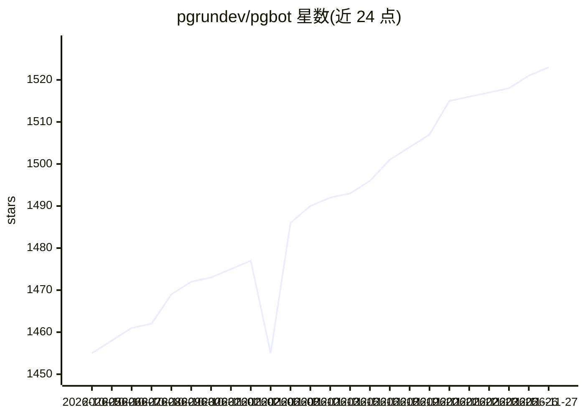

# pgrundev/pgbot

⭐ 1,523 · Go · NOASSERTION · 推送 2026-11-26 · [GitHub](https://github.com/pgrundev/pgbot) · [官网](https://pgbot.dev) · 个人维护

**面向 AI agent 的 PostgreSQL 只读诊断工具**

单个静态二进制以只读角色连接 PostgreSQL，读取数据库自带统计视图，输出以 findings 为先的健康报告（缓存命中、锁等待、无用索引、autovacuum、慢查询等），并对比基线指出变化。核心检查全部在 Go 中由 SQL 计算得出，确定性且无需 API key；可选的 ask/explain AI 层仅对同一批 findings 做自然语言解读。提供 MCP 服务器与版本化 --json 契约供 agent 消费。支持 PostgreSQL 14–18，Linux/macOS/Windows 的 amd64 与 arm64。

## 筛选速览

| 维度 | 判定 | 备注 |
|---|---|---|
| AI 角色 | `ai-ecosystem` | LLM/agent 周边工具 |
| 许可风险 | `permissive` | NOASSERTION |
| 部署形态 | `self-host` | docker 或自建部署 |
| 模型依赖 | — | README 未给出锁定关系 |
| 硬件要求 | — | 无带数字的原话,不猜 |
| 安装摩擦 | `low` | 无编译、无系统依赖或容器化 |
| 成熟度 | `idea` | |

## 能力要点

- 只读保障基于 pg_monitor 登录角色，路径中无写权限
- 每次运行写入本地基线，从第三次运行起报告变化
- findings 由 SQL 在 Go 中确定性计算，AI 层只解读不生成
- pgbot mcp 通过 Model Context Protocol 向 AI agent 输出 findings

## 适用场景

- 上线前对不熟悉的数据库做只读健康诊断
- 在 CI 中以退出码和 SARIF/JUnit 输出做门禁
- 让 AI agent 通过 MCP 获取结构化的 Postgres findings
- 比较两个基线快照定位查询回退原因

## 场景标签

 · 领域:数据库/可观测性工具

## 证据(README 行号)

> L100: |**Built for agents**|`--json` is a versioned, PII-free contract; `pgbot mcp` exposes the same findings over the M
> L211: |`mcp`|serve the findings to an AI agent over MCP|
> L104: pgbot is a **point-in-time diagnostic you run**, not a monitoring platform you

## 星数曲线

2026-10-25 1,455 → 2026-11-27 1,523（+68）

---
*卡片 v1 · prompt 1.4 · 生成 2026-11-24 · 置信度 high · 依据 README sha `616f1257e552` · [字段定义](../../DATASET.md)*
