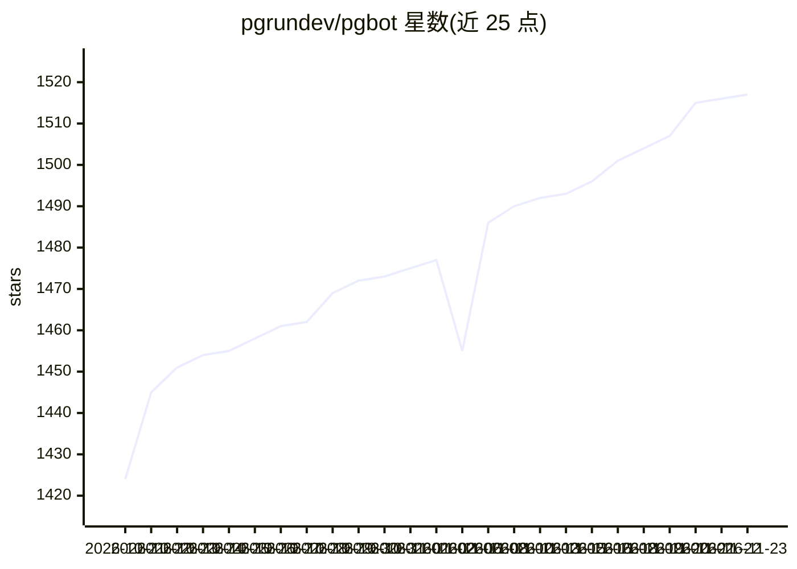

# pgrundev/pgbot

⭐ 1,517 · Go · NOASSERTION · 推送 2026-11-16 · [GitHub](https://github.com/pgrundev/pgbot) · [官网](https://pgbot.dev) · 个人维护

**面向 DBA 与 AI agent 的 Postgres 只读健康诊断 CLI**

单个静态二进制，以只读 pg_monitor 角色连接 PostgreSQL 14–18，读取数据库自身统计视图，输出以发现为先的健康报告（缓存命中、锁等待、回滚、空闲索引等），并从第三次运行起对比本地基线指出变化。所有发现由 Go 从 SQL 确定性计算；可选的 ask/explain 层仅对发现做自然语言解释，不生成发现。提供 --json 版本化契约与 MCP 服务，供 AI agent 消费结构化结果。无需部署任何服务，不要求写权限。

## 筛选速览

| 维度 | 判定 | 备注 |
|---|---|---|
| AI 角色 | `ai-enhanced` | 去掉 AI 部分产品仍成立 |
| 许可风险 | `permissive` | NOASSERTION |
| 部署形态 | `self-host` | docker 或自建部署 |
| 模型依赖 | local-ok | 支持本地模型 |
| 硬件要求 | — | 无带数字的原话,不猜 |
| 安装摩擦 | `low` | 无编译、无系统依赖或容器化 |
| 成熟度 | `idea` | |

## 能力要点

- 只读保障基于 pg_monitor 角色，叠加会话级只读与超时锁定
- 本地基线记录，可输出与上次运行相比的变化与回归解释
- --json 版本化契约（schema 1.5.0）与 pgbot mcp 服务面向 AI agent
- 可选 AI 层仅解释确定性发现，无 key 的功能完全离线运行

## 适用场景

- 快速体检一台不熟悉的 PostgreSQL 数据库而不部署监控平台
- 在 CI 中以退出码门禁拦截引入严重发现的迁移 PR
- 让 AI agent 通过 MCP 获取结构化的数据库诊断发现
- 排查变慢的查询、未使用索引与 autovacuum 滞后

## 场景标签

 · 领域:数据库/可观测性

## 证据(README 行号)

> L82: `pgbot explain` put a plain-language AI reading on top of the same findings.
> L98: |**Findings are deterministic**|Every finding is computed in Go from SQL. The optional AI layer explains findings; 
> L100: |**Built for agents**|`--json` is a versioned, PII-free contract; `pgbot mcp` exposes the same findings over the M
> L211: |`mcp`|serve the findings to an AI agent over MCP|

## 星数曲线

2026-10-21 1,424 → 2026-11-23 1,517（+93）

---
*卡片 v1 · prompt 1.4 · 生成 2026-11-23 · 置信度 high · 依据 README sha `18391ace1f32` · [字段定义](../../DATASET.md)*
