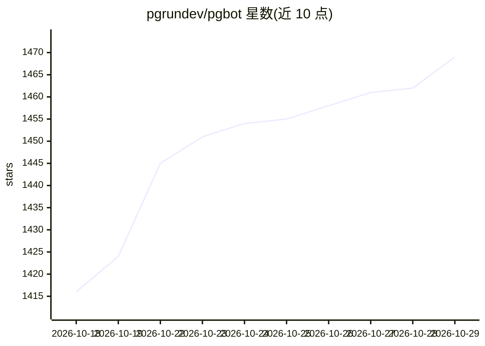

# pgrundev/pgbot

⭐ 1,469 · Go · NOASSERTION · 推送 2026-10-26 · [GitHub](https://github.com/pgrundev/pgbot) · [官网](https://pgbot.dev) · 个人维护

**只读 PostgreSQL 诊断 CLI，可选 AI 解读结果**

Go 编写的单二进制 PostgreSQL 诊断工具：以 pg_monitor 只读角色连接，读取 Postgres 自身统计视图，生成健康报告、慢查询排名、索引/表/vacuum 分析、ER 图等，并以本地基线对比展示变化；--json 输出为版本化契约，并提供 MCP 服务供 AI agent 读取结构化发现。inspect/queries 等核心命令完全确定性、无需 API key；可选的 ask/explain 命令调用 LLM 对同一发现做自然语言解读，AI 层只解释、不生成发现。支持 PostgreSQL 14–18，需 pg_monitor 角色可选依赖 pg_stat_statements/hypopg。

## 筛选速览

| 维度 | 判定 | 备注 |
|---|---|---|
| AI 角色 | `ai-enhanced` | 去掉 AI 部分产品仍成立 |
| 许可风险 | `permissive` | NOASSERTION |
| 部署形态 | `self-host` | docker 或自建部署 |
| 模型依赖 | local-ok | 支持本地模型 |
| 硬件要求 | — | 无带数字的原话,不猜 |
| 安装摩擦 | `low` | 无编译、无系统依赖或容器化 |
| 成熟度 | `idea` | |

## 能力要点

- 确定性发现计算，可选 AI 层只解释不生成
- 本地基线存储，报告变化与回归原因（diff/why）
- 版本化 --json 契约与 pgbot mcp 服务供 agent 接入
- 单静态二进制，无需部署采集器或数据库服务

## 适用场景

- 快速诊断我负责或不拥有的 Postgres 实例健康状态
- 在 CI 中用 lint 与 --fail-on 做数据库门禁
- 让 AI agent 通过 MCP 读取结构化 Postgres 发现做推理
- 排查慢查询、未使用索引与 autovacuum 积压

## 场景标签

 · 领域:数据库运维/可观测性

## 证据(README 行号)

> L63: Everything else — `inspect`, `queries`, `indexes`, MCP, CI — is fully
> L98: |**Findings are deterministic**|Every finding is computed in Go from SQL. The optional AI layer explains findings; 
> L208: |`ask "…"` · `explain`|a plain-language AI reading of the same deterministic findings|

## 星数曲线

2026-10-18 1,416 → 2026-10-29 1,469（+53）

---
*卡片 v1 · prompt 1.4 · 生成 2026-10-21 · 置信度 high · 依据 README sha `a44667b8e2fd` · [字段定义](../../DATASET.md)*
