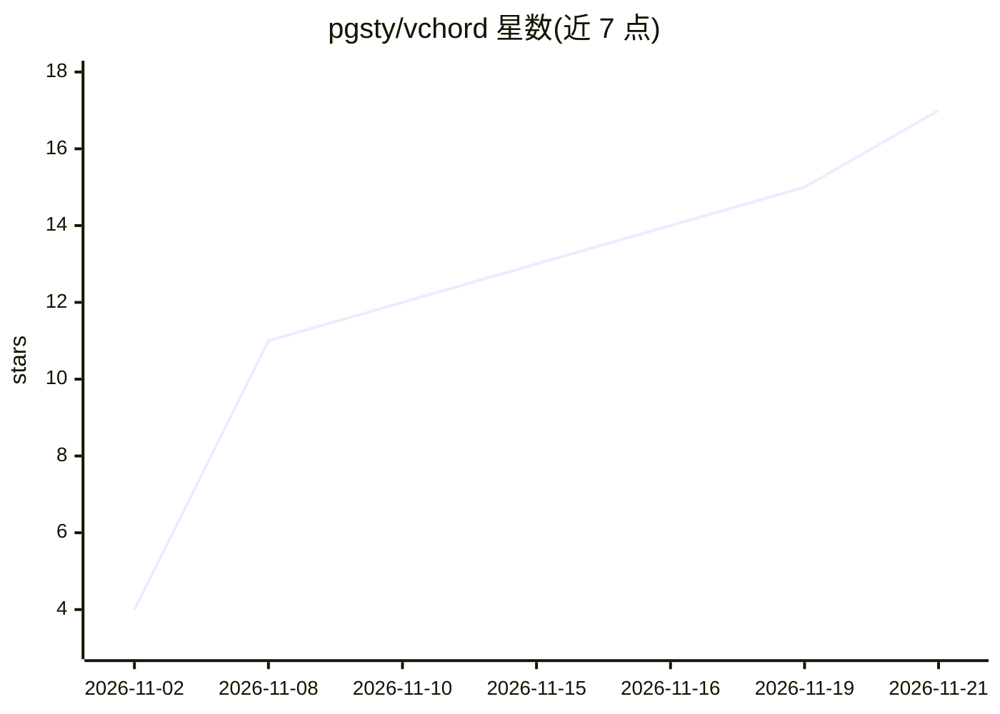

# pgsty/vchord

⭐ 17 · Rust · AGPL-3.0 · 推送 2026-11-20 · [GitHub](https://github.com/pgsty/vchord) · [官网](https://vchord.pgsty.com/docs/vchord) · 组织维护

**PostgreSQL 向量相似度检索扩展：磁盘友好的大规模 ANN 索引**

由 PGSTY 维护的 PostgreSQL 扩展，是 pgvecto.rs 的后继分支（VectorChord fork），提供可扩展、磁盘友好的向量相似度检索。结合 RaBitQ 量化与倒排文件（vchordrq）和单层图（vchordg）索引及库内重排，直接索引 pgvector 的 vector/halfvec 类型，支持 4-bit/8-bit 原生量化类型与多向量 MaxSim 检索。支持 PostgreSQL 14-18，通过 pig 原生包、Docker 镜像或源码构建安装，需加入 shared_preload_libraries 并重启 PostgreSQL。

## 筛选速览

| 维度 | 判定 | 备注 |
|---|---|---|
| AI 角色 | `ai-ecosystem` | LLM/agent 周边工具 |
| 许可风险 | `viral` | AGPL-3.0 |
| 部署形态 | `self-host` | docker 或自建部署 |
| 模型依赖 | — | README 未给出锁定关系 |
| 硬件要求 | — | 无带数字的原话,不猜 |
| 安装摩擦 | `low` | 无编译、无系统依赖或容器化 |
| 成熟度 | — | 结构信号不足 |

## 能力要点

- RaBitQ 量化 + 倒排文件（vchordrq）/单层图（vchordg）索引 + 库内重排
- 直接索引 pgvector 数据类型（vector/halfvec），支持 <->/<#>/<=> 距离算子
- 原生 4-bit（rabitq4）/8-bit（rabitq8）量化类型，rabitq8 召回损失 <1%
- 多向量 MaxSim（@#）检索与混合检索套件（vchord_bm25/pg_tokenizer）

## 适用场景

- 在现有 PostgreSQL 中存储和检索大规模向量，无需独立向量数据库
- 亿级向量的低成本磁盘索引构建与最近邻查询
- 向量 + BM25 全文混合检索（配合 Vchord Suite 其他扩展）

## 场景标签

`向量数据库` · 领域:知识与检索

## 证据(README 行号)

> L11: **`vchord`** is a PostgreSQL extension engineered for scalable, high-performance, and disk-friendly vector similari
> L32: - **Drop-In `pgvector` Compatibility**: Directly indexes `pgvector` data types (`vector`, `halfvec`) and supports s

## 星数曲线

2026-11-02 4 → 2026-11-21 17（+13）

---
*卡片 v1 · prompt 1.4 · 生成 2026-11-18 · 置信度 high · 依据 README sha `a49173a6a7e1` · [字段定义](../../DATASET.md)*
