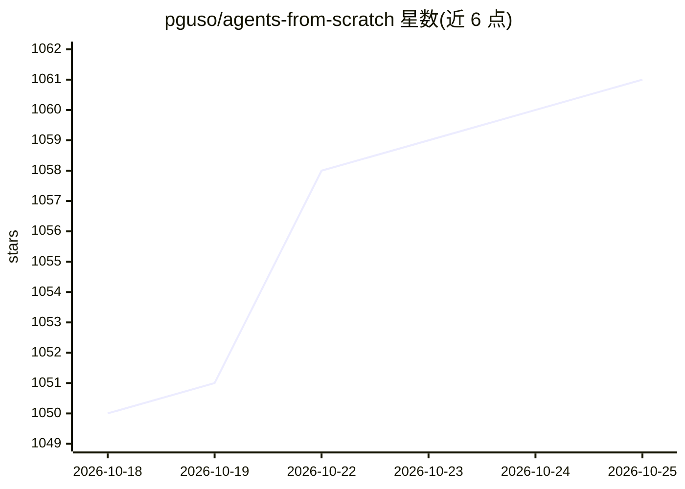

# pguso/agents-from-scratch

⭐ 1,061 · Python · MIT · 推送 2026-07-25 · [GitHub](https://github.com/pguso/agents-from-scratch) · 个人维护

**本地 LLM 从零构建 AI agent 的 12 课教程仓库**

教学仓库：不使用框架与云 API，基于单次本地 LLM 调用逐步构建一个 agent，跨 12 课演进同一 Agent 类，覆盖系统提示、结构化输出、工具调用、agent 循环、记忆、规划、评测与遥测。面向会写代码但不熟悉 agent 原理的开发者、学习本地模型者与教育者；明确声明非生产框架。快速开始需 pip 安装依赖、下载 GGUF 模型到 models/ 目录并运行 complete_example.py。

## 筛选速览

| 维度 | 判定 | 备注 |
|---|---|---|
| AI 角色 | `ai-knowledge` | 知识聚合/清单类 |
| 许可风险 | `permissive` | MIT |
| 部署形态 | `library` | 以包/库形式分发 |
| 模型依赖 | local-ok | 支持本地模型 |
| 硬件要求 | — | 无带数字的原话,不猜 |
| 安装摩擦 | `low` | 无编译、无系统依赖或容器化 |
| 成熟度 | — | 结构信号不足 |

## 能力要点

- 12 课在同一个 agent.py 上逐步演进 agent 能力
- 无框架、无云 API，仅需本地 GGUF 模型
- complete_example.py 包含全部 12 课的可执行示例
- 含评测（回归测试）与遥测（延迟/成功率/追踪）章节

## 适用场景

- 系统学习 AI agent 从 LLM 调用到工具与规划的实现原理
- 不用框架在本地模型上理解 agent 循环与记忆机制
- 作为教学材料讲解 agent 的机械式工作方式

## 场景标签

`教程课程` · 领域:学习与行业

## 证据(README 行号)

> L5: This repository teaches how AI agents actually work by building **one agent** step by step from a single local LLM c
> L33: This repository builds one continuously evolving agent across 12 lessons:

## 星数曲线

2026-10-18 1,050 → 2026-10-25 1,061（+11）

---
*卡片 v1 · prompt 1.4 · 生成 2026-10-21 · 置信度 mid · 依据 README sha `7453e9a05f40` · [字段定义](../../DATASET.md)*
