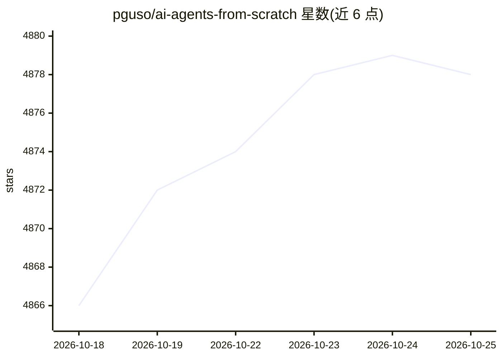

# pguso/ai-agents-from-scratch

⭐ 4,878 · JavaScript · MIT · 推送 2026-07-24 · [GitHub](https://github.com/pguso/ai-agents-from-scratch) · 个人维护

**教学仓库：用本地 LLM 从零构建 AI agent，不依赖框架**

面向学习者的 Node.js 教学仓库，通过 15 个渐进式示例讲解 AI agent 的底层机制：从基础 LLM 调用、系统提示词、流式输出，到函数调用、持久记忆、ReAct、Tree/Graph/Chain of Thought、错误处理与基于嵌入的工具路由。全部示例基于 node-llama-cpp 在本地运行 GGUF 模型，另含一个可选的 OpenAI 托管模型示例。每个示例文件夹附逐步代码讲解与概念文档，并有配套网站 agentsfromscratch.com。需 Node.js 18+ 与至少 8GB 内存（推荐 16GB），模型需自行下载放入 ./models/。

## 筛选速览

| 维度 | 判定 | 备注 |
|---|---|---|
| AI 角色 | `ai-knowledge` | 知识聚合/清单类 |
| 许可风险 | `permissive` | MIT |
| 部署形态 | `library` | 以包/库形式分发 |
| 模型依赖 | — | README 未给出锁定关系 |
| 硬件要求 | — | 无带数字的原话,不猜 |
| 安装摩擦 | `low` | 无编译、无系统依赖或容器化 |
| 成熟度 | — | 结构信号不足 |

## 能力要点

- 15 个渐进式示例覆盖函数调用、记忆、ReAct、ToT/GoT/CoT 等模式
- 基于 node-llama-cpp 本地运行 GGUF 模型，不依赖框架
- 每示例附 CODE.md 逐步讲解与 CONCEPT.md 概念文档
- 含 PromptDebugger 调试工具与配套概念网站

## 适用场景

- 在使用生产框架前理解 agent 底层工作原理
- 动手学习函数调用、记忆与 ReAct 等 agent 模式
- 对比 Tree of Thought 与 Graph of Thought 等推理范式

## 场景标签

`教程课程` · 领域:学习与行业

## 证据(README 行号)

> L3: Learn to build AI agents locally without frameworks. Understand what happens under the hood before using production 
> L9: This repository teaches you to build AI agents from first principles using **local LLMs** and **node-llama-cpp**. By

## 星数曲线

2026-10-18 4,866 → 2026-10-25 4,878（+12）

---
*卡片 v1 · prompt 1.4 · 生成 2026-10-20 · 置信度 high · 依据 README sha `98d804946b77` · [字段定义](../../DATASET.md)*
