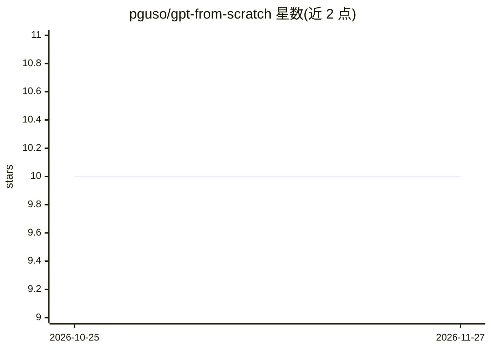

# pguso/gpt-from-scratch

⭐ 10 · Python · MIT · 推送 2026-02-08 · [GitHub](https://github.com/pguso/gpt-from-scratch) · 个人维护

**教学用从零实现小型 GPT 的 PyTorch 学习项目**

面向想深入理解大语言模型工作原理的开发者，提供从零实现的 GPT transformer 代码库，采用先概念后代码的自顶向下教学路线。通过三个脚本完成完整流程：运行未训练模型查看结构、在 TinyStories 数据集上训练（保存 checkpoint）、用训练后模型生成文本，另提供注意力模式可视化脚本。支持 CPU/CUDA/MPS 设备切换，训练时长取决于模型规模与硬件。需基础 Python，PyTorch 知识有帮助但非必需。

## 筛选速览

| 维度 | 判定 | 备注 |
|---|---|---|
| AI 角色 | `ai-knowledge` | 知识聚合/清单类 |
| 许可风险 | `permissive` | MIT |
| 部署形态 | `library` | 以包/库形式分发 |
| 模型依赖 | — | README 未给出锁定关系 |
| 硬件要求 | — | 无带数字的原话,不猜 |
| 安装摩擦 | `medium` | 含编译或系统依赖之一 |
| 成熟度 | — | 结构信号不足 |

## 能力要点

- quickstart/train/generate 三步式学习路径，含对比表
- analyze_attention.py 可视化模型注意力模式
- 训练脚本提供命令行超参数（嵌入维度、层数、样本数等）
- 依赖 TinyStories 数据集，下载失败可回退样例数据

## 适用场景

- 作为开发者入门 transformer 架构的动手教程
- 作为研究人员需要的简洁 GPT 参考实现
- 通过训练与文本生成理解大语言模型的工作机制

## 场景标签

`教程课程` · 领域:学习与行业

## 证据(README 行号)

> L1: # GPT From Scratch: A Top-Down Learning Journey
> L3: A comprehensive, educational implementation of GPT (Generative Pre-trained Transformer) designed for developers who 
> L9: - Top-down approach: Start with concepts, then dive into code

## 星数曲线

2026-10-25 10 → 2026-11-27 10（+0）

---
*卡片 v1 · prompt 1.4 · 生成 2026-11-19 · 置信度 mid · 依据 README sha `b78b7fed0aa8` · [字段定义](../../DATASET.md)*
