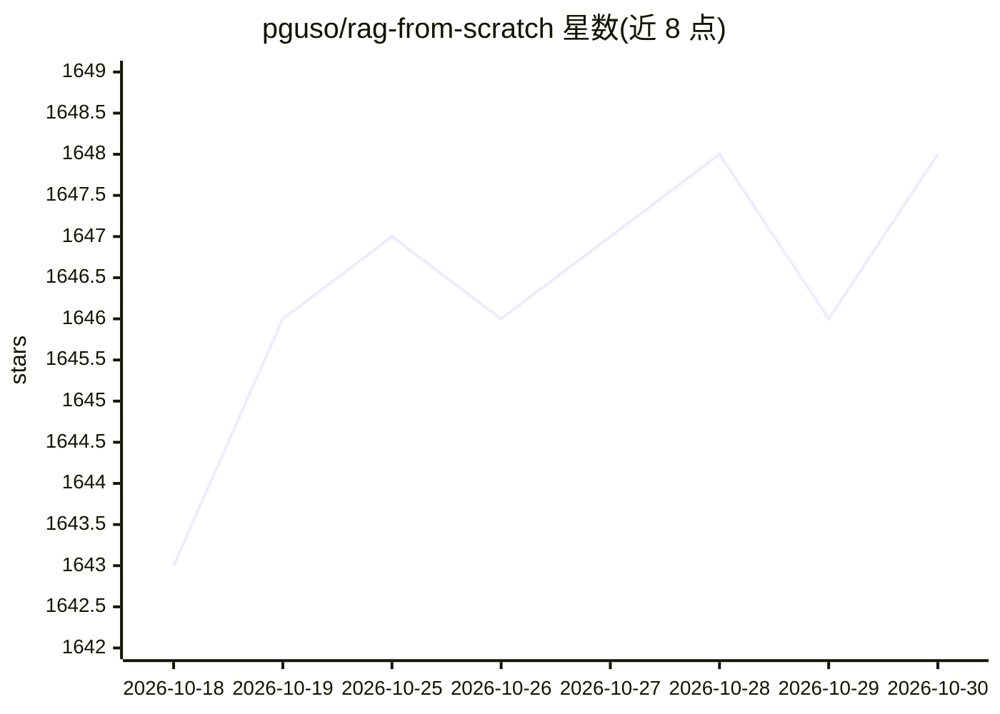

# pguso/rag-from-scratch

⭐ 1,648 · JavaScript · MIT · 推送 2026-03-11 · [GitHub](https://github.com/pguso/rag-from-scratch) · 个人维护

**面向开发者的 RAG 从零实现教程：本地 LLM、逐步代码讲解**

教育性质的 Node.js 项目：以渐进式示例（数据加载、分块、嵌入、内存向量库、检索策略、混合检索、多查询 RRF 融合、查询改写等）从零讲解 RAG 全流程，不依赖云 API，本地 LLM 通过 node-llama-cpp 运行（示例含 Qwen 3-1 改写）。同时提供可复用库代码（loaders、splitters、embeddings、vector stores、retrievers、chains、prompts）。部分功能（重排序、评估、生产化示例、图数据库集成）列为规划中。需要 Node.js 18+。

## 筛选速览

| 维度 | 判定 | 备注 |
|---|---|---|
| AI 角色 | `ai-knowledge` | 知识聚合/清单类 |
| 许可风险 | `permissive` | MIT |
| 部署形态 | `library` | 以包/库形式分发 |
| 模型依赖 | — | README 未给出锁定关系 |
| 硬件要求 | — | 无带数字的原话,不猜 |
| 安装摩擦 | `low` | 无编译、无系统依赖或容器化 |
| 成熟度 | — | 结构信号不足 |

## 能力要点

- 按 00–12 编号组织的渐进式 RAG 示例，每个示例配解释与概念文档
- 本地运行：node-llama-cpp 加载本地 LLM，无云 API 依赖
- 检索策略覆盖 BM25+向量混合检索、多查询分解与 RRF 融合、启发式/LLM 查询改写
- src/ 提供可复用库代码（加载器、分块、嵌入、向量库、检索器等）

## 适用场景

- 想理解 RAG 底层原理（嵌入、向量检索、上下文增强）并亲手实现
- 不用黑盒框架、逐行读懂 RAG 各环节的开发者学习路径
- 参考检索策略实现（混合检索、多查询融合、查询改写）用于自己的项目

## 场景标签

`RAG` `教程课程` · 领域:知识与检索

## 证据(README 行号)

> L5: **Demystify Retrieval-Augmented Generation (RAG) by building it yourself - step by step.**
> L176: This project is being built **step by step**, following an educational approach where each concept is introduced i
> L248: This repository is not about fancy frameworks or huge models.

## 星数曲线

2026-10-18 1,643 → 2026-10-30 1,648（+5）

---
*卡片 v1 · prompt 1.4 · 生成 2026-10-21 · 置信度 high · 依据 README sha `9d17b1919316` · [字段定义](../../DATASET.md)*
