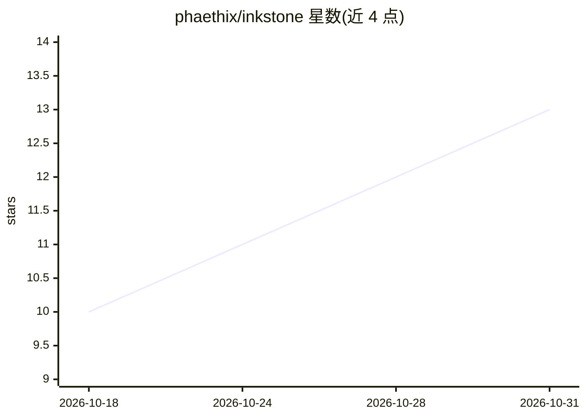

# phaethix/inkstone

⭐ 13 · Python · MIT · 推送 2026-10-30 · [GitHub](https://github.com/phaethix/inkstone) · [官网](https://phaethix.github.io/inkstone/) · 个人维护

**读本地小说生成连载漫画页的工具，免费 API、无需 GPU**

读取本地 txt 小说，调用免费的 Agnes 多模态 API 完成剧本、分页绘制与文字排版，导出 PDF/CBZ/PNG，含 webtoon 模式。跨面板角色一致性靠 L1 提示词硬描述 + L2 参考图 img2img 实现，可选 L3 面部叠加默认关闭。提供限流重试、state.json 断点续跑、零依赖本地 Web UI 与 prompt 树 A/B 实验工具。限制：仅云端免费 API、一致性上限受无 GPU 前提约束。

## 筛选速览

| 维度 | 判定 | 备注 |
|---|---|---|
| AI 角色 | `ai-native` | 本体是模型或模型工具 |
| 许可风险 | `permissive` | MIT |
| 部署形态 | `library` | 以包/库形式分发 |
| 模型依赖 | — | README 未给出锁定关系 |
| 硬件要求 | — | 无带数字的原话,不猜 |
| 安装摩擦 | `low` | 无编译、无系统依赖或容器化 |
| 成熟度 | — | 结构信号不足 |

## 能力要点

- L1+L2 分层角色一致性策略，L3 面部叠加可选
- 断点续跑、限流与指数退避重试
- 整页绘制+真实字体排版（支持 CJK），未上字图可缓存复用
- 可插拔 ImageProvider，兼容 openai_compat 网关

## 适用场景

- 把本地小说章节批量转成漫画 PDF/CBZ
- 通过 Web UI 粘贴小说生成分页或条漫
- 用 A/B 实验调优 prompt 树后再生成

## 场景标签

`图像生成` · 领域:内容生成

## 证据(README 行号)

> L11: **Inkstone** reads a local `txt` novel and, through the free **Agnes** multimodal API, produces comic pages with cr
> L26: - **Agnes-native multimodal** — `agnes-3.0-flash` for scripting, `agnes-image-2.5-flash` for t2i and i2i consistenc

## 星数曲线

2026-10-18 10 → 2026-10-31 13（+3）

---
*卡片 v1 · prompt 1.4 · 生成 2026-10-31 · 置信度 mid · 依据 README sha `40e4c1160898` · [字段定义](../../DATASET.md)*
