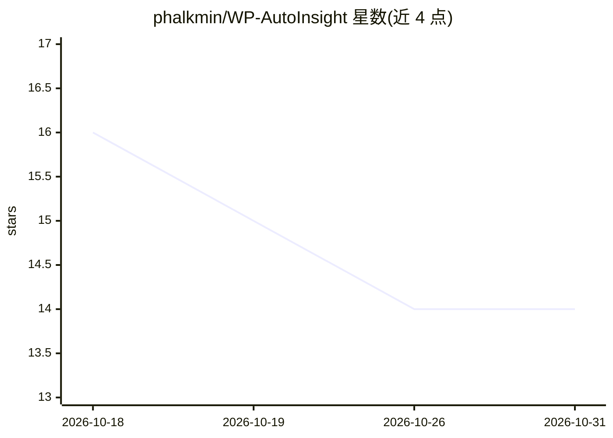

# phalkmin/WP-AutoInsight

⭐ 14 · PHP · GPL-3.0 · 推送 2026-10-12 · [GitHub](https://github.com/phalkmin/WP-AutoInsight) · [官网](https://wpautoinsight.phalkmin.me/) · 个人维护

**WordPress 插件：用自有 API 密钥定时生成 AI 博客文章**

面向 WordPress 用户的 AI 内容生成插件（需 WordPress 6.8+、PHP 7.4）：用户接入自己的 OpenAI、Anthropic Claude、Google Gemini、Perplexity API 密钥，从关键词列表或话题库定时（小时到周）生成文章，默认保存为草稿供人工审核。支持音频转写为文章、AI 信息图生成、现有文章改写；图片生成可选 OpenAI GPT Image、Stability AI 或 Gemini；与 Yoast SEO/RankMath 集成自动生成 SEO 元数据；主服务商不可用时可配置回退。密钥可存于 wp-config.php 或 WordPress Connectors。

## 筛选速览

| 维度 | 判定 | 备注 |
|---|---|---|
| AI 角色 | `ai-native` | 本体是模型或模型工具 |
| 许可风险 | `viral` | GPL-3.0 |
| 部署形态 | `None` |  |
| 模型依赖 | locked-api |  |
| 硬件要求 | — | 无带数字的原话,不猜 |
| 安装摩擦 | `low` | 无编译、无系统依赖或容器化 |
| 成熟度 | — | 结构信号不足 |

## 能力要点

- 支持 OpenAI/Claude/Gemini/Perplexity 四家服务商，可按关键词组分配不同模型
- 话题库定时自动生成文章，产出默认为草稿待审核
- 音频转写（MP3/WAV/M4A/WebM/FLAC，≤25MB）转为结构化文章
- Perplexity 实时联网检索并附带可点击来源引用

## 适用场景

- 我是小企业主，想让博客按关键词自动保持更新
- 我是代理机构，替客户管理多站点内容并审核后发布
- 我想把会议录音或语音笔记转成博客草稿
- 我想让文章自动带 SEO 元数据和特色图片

## 场景标签

`AI 写作` · 领域:内容生成

## 证据(README 行号)

> L11: Writes posts on a schedule with your own OpenAI, Claude, Gemini or Perplexity keys, adds images and SEO metadata, a
> L29:  - Supports OpenAI, Anthropic Claude, Google Gemini, and Perplexity models. Switch models anytime you want

## 星数曲线

2026-10-18 16 → 2026-10-31 14（-2）

---
*卡片 v1 · prompt 1.4 · 生成 2026-10-31 · 置信度 high · 依据 README sha `2d05db0dd4d0` · [字段定义](../../DATASET.md)*
