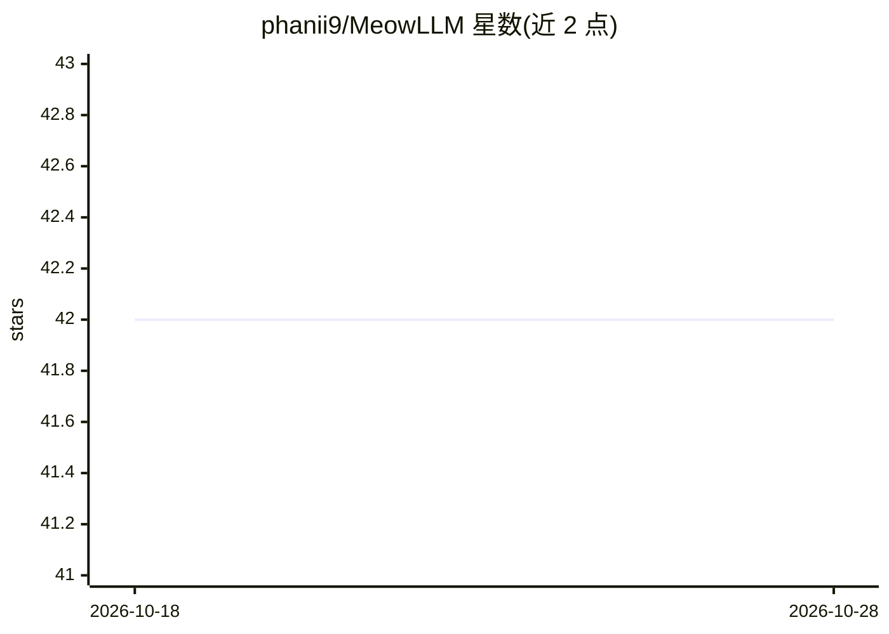

# phanii9/MeowLLM

⭐ 42 · Python · MIT · 推送 2026-04-06 · [GitHub](https://github.com/phanii9/MeowLLM) · 个人维护

**从零训练的 3.5M 参数猫咪角色语言模型（含完整训练管线）**

一个约 3.45M 参数的 decoder-only transformer（RoPE/RMSNorm/SwIGLU/SDPA），从零训练为单一角色——家猫 Miso，无系统提示、无微调。提供完整可复现管线：槽位组合式数据生成器、字节级 BPE 分词器、训练循环、5 维评测（38 个留出提示，整体通过率 84.2%）、68 个自动化测试与 CI，约 2,800 行 Python。可通过 Colab 笔记本在 T4 上约 20 分钟训练，或在 CPU 上对话，附 Hugging Face 数据集（20K 样本）与预训练 checkpoint。面向想学习从零构建角色语言模型的开发者。

## 筛选速览

| 维度 | 判定 | 备注 |
|---|---|---|
| AI 角色 | `ai-native` | 本体是模型或模型工具 |
| 许可风险 | `permissive` | MIT |
| 部署形态 | `library` | 以包/库形式分发 |
| 模型依赖 | — | README 未给出锁定关系 |
| 硬件要求 | — | 无带数字的原话,不猜 |
| 安装摩擦 | `low` | 无编译、无系统依赖或容器化 |
| 成熟度 | — | 结构信号不足 |

## 能力要点

- 从零训练的角色 LM：人格存在于权重中，无系统提示/微调
- 槽位组合式数据生成 + 生成器与评测共用的严格过滤模块
- 5 维评测框架（38 个留出提示，含 8 个助手陷阱）
- 68 个自动化测试，约 8 秒跑完；T4 上约 20 分钟完成训练

## 适用场景

- 学习从数据生成到推理的完整小模型训练流程
- 在 Colab 免费算力上复现或改造角色语言模型
- 研究小参数量下角色一致性的数据与过滤策略

## 场景标签

`模型训练` `模型评测` `教程课程` · 领域:评测与运维

## 证据(README 行号)

> L15: **MeowLLM** is a ~3.5M parameter language model trained from scratch to speak as a single character: a house cat na
> L28: This project exists to show that training a character language model is not magic. One Colab notebook, ~20 minutes,

## 星数曲线

2026-10-18 42 → 2026-10-28 42（+0）

---
*卡片 v1 · prompt 1.4 · 生成 2026-10-25 · 置信度 high · 依据 README sha `4d03a6be8fe5` · [字段定义](../../DATASET.md)*
