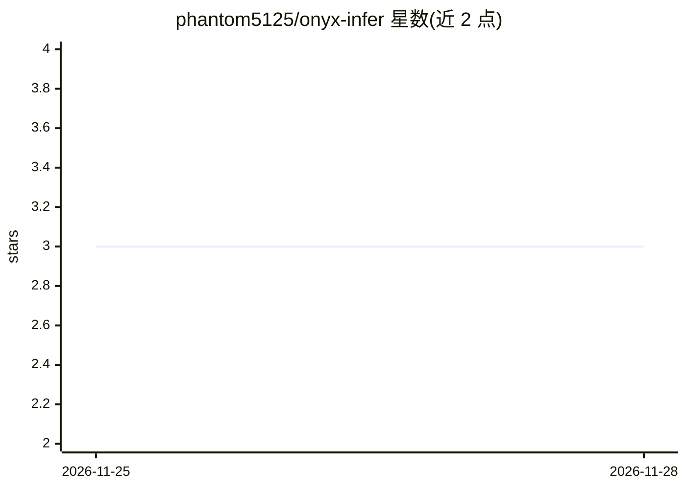

# phantom5125/onyx-infer

⭐ 3 · C++ · MIT · 推送 2026-11-26 · [GitHub](https://github.com/phantom5125/onyx-infer) · [官网](https://phantom5125.github.io/onyx-infer/) · 个人维护 · 中文 README

**在 Apple Silicon 上本地运行 MiniMax H3 生成 4096×4096 图像的推理引擎**

用 C++20 与 Metal 4 实现的图像生成推理引擎，本地运行 MiniMax-H3-Image 的文本编码器、33.1B DiT 与 VAE，支持不经放大器直接生成 4096×4096 图像。针对约 135 GB 检查点超出统一内存工作集的问题，采用分组 W4 量化、分块流式加载、权重驻留调度与调制缓存等机制。三种执行档案覆盖质量、内存与速度偏好，运行记录以 protobuf v1 协议落盘并可用 SHA-256 复现。附带基准结果 JSON 与 Onyx Studio 工具。

## 筛选速览

| 维度 | 判定 | 备注 |
|---|---|---|
| AI 角色 | `ai-native` | 本体是模型或模型工具 |
| 许可风险 | `permissive` | MIT |
| 部署形态 | `None` |  |
| 模型依赖 | — | README 未给出锁定关系 |
| 硬件要求 | — | 无带数字的原话,不猜 |
| 安装摩擦 | `low` | 无编译、无系统依赖或容器化 |
| 成熟度 | — | 结构信号不足 |

## 能力要点

- 4096×4096 直接生成（一个 token=32×32 像素），无需放大器
- 分组 W4 量化 + 分块流式 + 权重预取，应对 135 GB 检查点与统一内存限制
- 六份 protobuf v1 协议、RunRecord 与输出 SHA-256 复现机制
- 三个 W4 执行档案：max-quality / memory-min / speed-focus

## 适用场景

- 在 Mac Studio / MacBook 上本地离线生成高分辨率图像
- 统一内存紧张的机器用 memory-min 档案流式加载权重
- 复现并核对基准数据后再采用优化配置

## 场景标签

`图像生成` `推理引擎` `模型量化` · 领域:内容生成

## 证据(README 行号)

> L15: Generate **4096×4096 images directly on Apple Silicon** with MiniMax-H3-Image. Onyx Infer runs the text encoder, 33
> L59: - **Full-native pipeline, zero runtime reuse** — MPSGraph + hand-written MSL kernels over our

## 星数曲线

2026-11-25 3 → 2026-11-28 3（+0）

---
*卡片 v1 · prompt 1.4 · 生成 2026-11-24 · 置信度 high · 依据 README sha `83ef32cc2622` · [字段定义](../../DATASET.md)*
