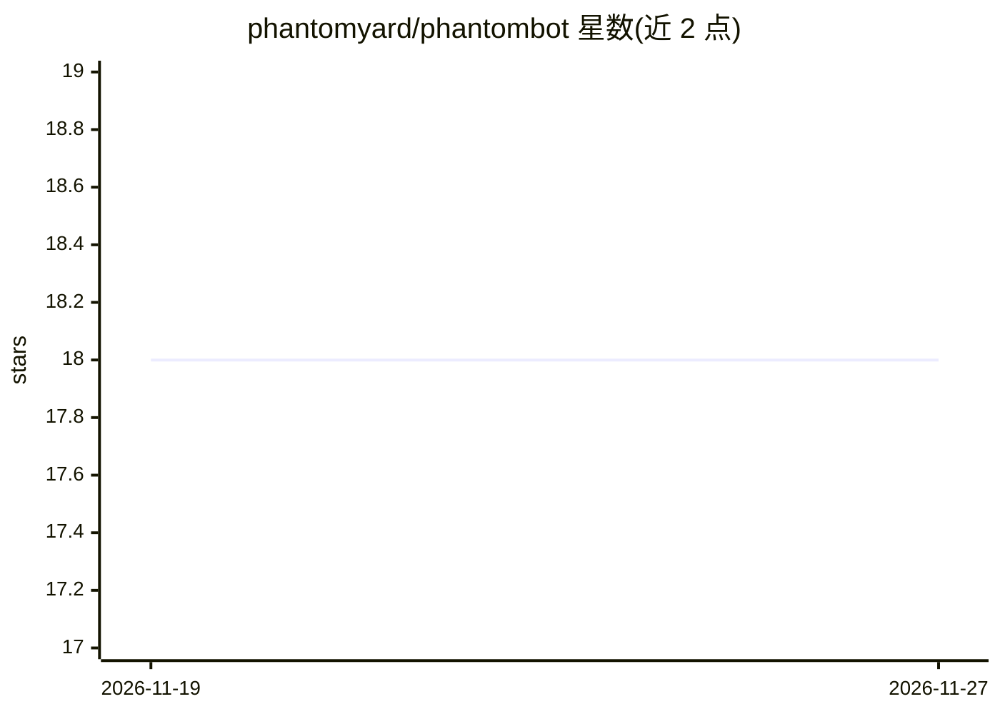

# phantomyard/phantombot

⭐ 18 · TypeScript · MIT · 推送 2026-11-26 · [GitHub](https://github.com/phantomyard/phantombot) · [官网](https://phantombot.bot/) · 组织维护

**给终端/聊天/编辑器提供持久化本地 AI 人格的代理运行时**

Phantombot 为 AI harness 提供持久身份与长期记忆（日志、决策、知识库本地可检索）、AES-256-GCM 加密凭据库、定时后台任务，并可通过 PhantomChat、Telegram、终端或编辑器与同一人格交互。内置原生 harness，也可驱动已有的 Pi、Claude Code 或 Codex 安装，或接入任意 OpenAI 兼容端点；外部来信、webhook 与定时唤醒经威胁判定后沙箱执行。安装脚本覆盖 Linux/macOS/Windows 并注册后台服务，需要模型 API key。

## 筛选速览

| 维度 | 判定 | 备注 |
|---|---|---|
| AI 角色 | `ai-native` | 本体是模型或模型工具 |
| 许可风险 | `permissive` | MIT |
| 部署形态 | `None` |  |
| 模型依赖 | — | README 未给出锁定关系 |
| 硬件要求 | — | 无带数字的原话,不猜 |
| 安装摩擦 | `low` | 无编译、无系统依赖或容器化 |
| 成熟度 | — | 结构信号不足 |

## 能力要点

- 跨聊天、终端、编辑器的连续人格与本地可检索长期记忆
- 原生 harness 或 Pi、Claude Code、Codex，支持 fallback 与 OpenAI 兼容端点
- 来信/定时唤醒经威胁判定后沙箱运行，人格状态与密钥留在本地
- 提供 doctor 健康检查、MCP 外部集成调用与后台服务管理命令

## 适用场景

- 在终端和编辑器中维护一个跨会话记忆的 AI 助手
- 通过 Telegram 或 PhantomChat 远程联系同一人格代理
- 让代理执行定时任务、健康检查与后台通知

## 场景标签

`Agent 记忆` `AI 助手` · 领域:Agent 开发

## 证据(README 行号)

> L8: **A persistent, local-first AI persona for your terminal, chats, and editor.**
> L13: remembers. It ships with a native harness and can also drive your existing Pi,
> L40: - **Bring your own brain** — native harness or Pi, Claude Code, and Codex, with

## 星数曲线

2026-11-19 18 → 2026-11-27 18（+0）

---
*卡片 v1 · prompt 1.4 · 生成 2026-11-19 · 置信度 high · 依据 README sha `588c4e7303f5` · [字段定义](../../DATASET.md)*
