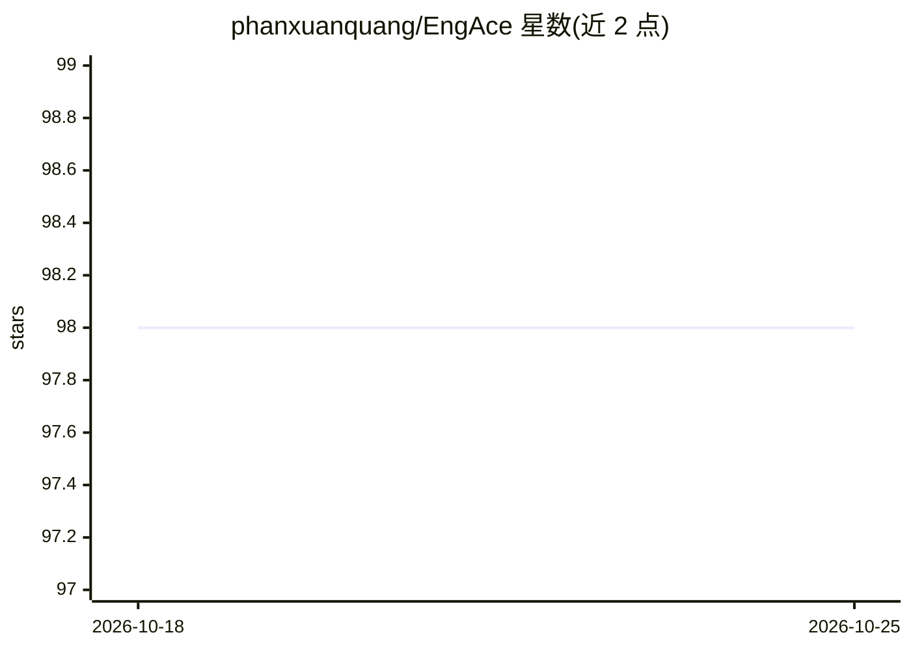

# phanxuanquang/EngAce

⭐ 98 · TypeScript · NOASSERTION · 推送 2026-05-18 · [GitHub](https://github.com/phanxuanquang/EngAce) · [官网](https://engace.vercel.app) · 组织维护

**面向越南学习者的生成式 AI 英语学习应用**

EngAce 是一款面向越南英语学习者的生成式 AI 应用，含四大功能：面向越南语用户的智能词典（例句与语境搜索）、个性化练习生成（最多 100 题/次、12 种题型、自适应难度）、写作批改（语法/风格/连贯性反馈），以及 AI 专家聊天机器人（Google 搜索接地验证、深度思考、图片附件）。技术栈涉及 ASP.NET Core 8 与 Gemini，用户的 Gemini API Key 与 Google 账号信息仅存于个人设备，登出后删除。采用 CC BY-NC-SA 4.0 许可。

## 筛选速览

| 维度 | 判定 | 备注 |
|---|---|---|
| AI 角色 | `ai-native` | 本体是模型或模型工具 |
| 许可风险 | `none` | NOASSERTION |
| 部署形态 | `None` |  |
| 模型依赖 | — | README 未给出锁定关系 |
| 硬件要求 | — | 无带数字的原话,不猜 |
| 安装摩擦 | `low` | 无编译、无系统依赖或容器化 |
| 成熟度 | — | 结构信号不足 |

## 能力要点

- 个性化练习生成：单次最多 100 题、12 种题型、自适应难度
- 聊天机器人支持 Google 搜索接地验证与图片附件
- 面向越南语母语者的英语词典，附例句与语境搜索
- AI 写作批改：语法、风格与连贯性反馈

## 适用场景

- 按自身水平生成英语练习题并自适应提升
- 提交英语作文获得语法与风格反馈
- 与 AI 聊天机器人讨论英语学习问题并要求联网验证回答
- 查询单词的越南语语境释义与例句

## 场景标签

`聊天机器人` `AI 写作` · 领域:对话与助手

## 证据(README 行号)

> L3: EngAce is a cutting-edge, generative AI-powered application designed to revolutionize the way Vietnamese learn Engli
> L45: Instantly receive detailed feedback and constructive suggestions to enhance writing skills, helping users improve t

## 星数曲线

2026-10-18 98 → 2026-10-25 98（+0）

---
*卡片 v1 · prompt 1.4 · 生成 2026-10-23 · 置信度 mid · 依据 README sha `1036c334ad24` · [字段定义](../../DATASET.md)*
