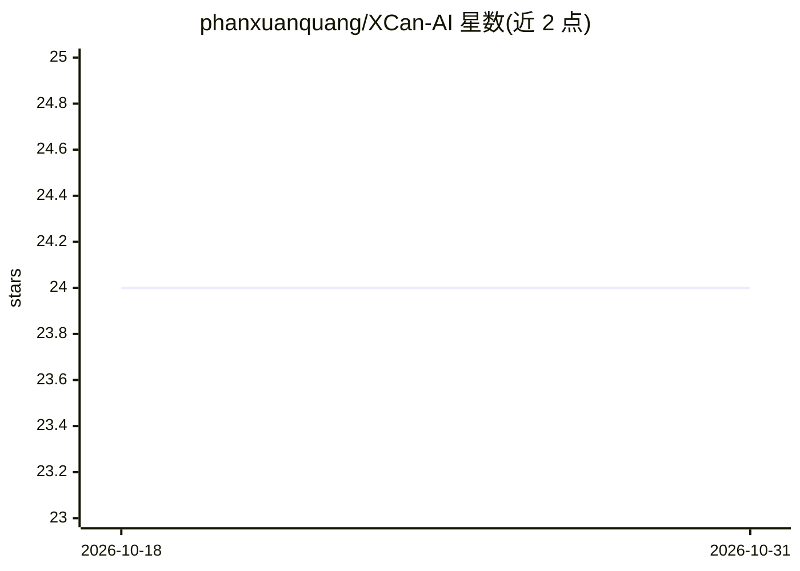

# phanxuanquang/XCan-AI

⭐ 24 · TypeScript · 推送 2026-05-18 · [GitHub](https://github.com/phanxuanquang/XCan-AI) · [官网](https://xcan.vercel.app) · 个人维护

**基于 Gemini 的图片文字提取与越南语翻译 Web 应用**

用户提供 Gemini API key，通过粘贴、拖拽或选择本地图片，由 AI 提取图中文字（含表格、代码、数学公式），并保持原版式布局；还可一键将提取文字翻译为越南语且不改变格式。技术栈为 .NET 8.0 后端（XCan.Api）+ Node.js 前端（xcan.web），需从源码构建运行，依赖外部 Gemini API key，无预编译桌面安装包。

## 筛选速览

| 维度 | 判定 | 备注 |
|---|---|---|
| AI 角色 | `ai-native` | 本体是模型或模型工具 |
| 许可风险 | `none` | — |
| 部署形态 | `library` | 以包/库形式分发 |
| 模型依赖 | — | README 未给出锁定关系 |
| 硬件要求 | — | 无带数字的原话,不猜 |
| 安装摩擦 | `medium` | 含编译或系统依赖之一 |
| 成熟度 | — | 结构信号不足 |

## 能力要点

- 提取图片文字并保留原始版式与格式
- 支持表格、代码片段、数学公式等内容
- 提取文字可翻译为越南语且不改格式
- 图片输入支持粘贴（Ctrl+V）、本地选择与拍照

## 适用场景

- 我想把手写或印刷图片里的文字转成可编辑文本
- 我需要把图片中的表格、公式、代码按原格式提取出来
- 我想把图片里的内容直接翻译成越南语

## 场景标签

`OCR` · 领域:感知与多模态

## 证据(README 行号)

> L4: The users just input the image by pasting (`Ctrl + V`) or select the image from the local device, then the AI handle
> L82: 1. **Gemini API Key**: Obtain a Gemini API key from Google AI Studio and enter it in the application.

## 星数曲线

2026-10-18 24 → 2026-10-31 24（+0）

---
*卡片 v1 · prompt 1.4 · 生成 2026-10-27 · 置信度 mid · 依据 README sha `b2206da66fc6` · [字段定义](../../DATASET.md)*
