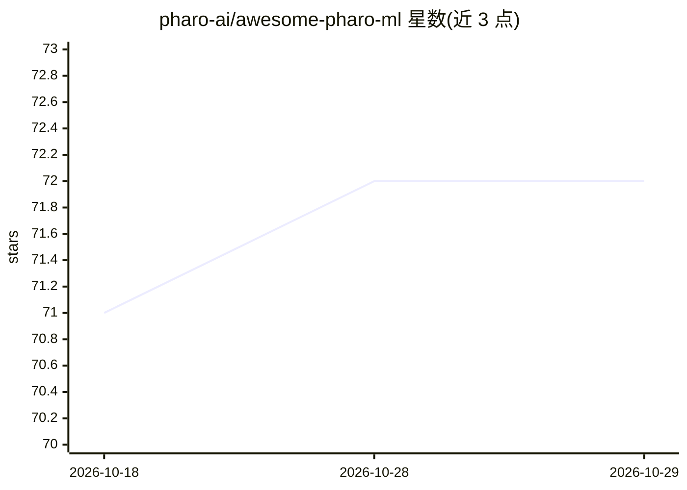

# pharo-ai/awesome-pharo-ml

⭐ 72 · MIT · 推送 2026-04-09 · [GitHub](https://github.com/pharo-ai/awesome-pharo-ml) · 组织维护

**Pharo 生态机器学习项目与资料聚合清单**

收录 Pharo 语言相关机器学习项目、书籍、论文与教程的分类清单，条目覆盖 LLM 推理引擎、数学库、线性模型、神经网络、深度学习绑定、NLP、数据挖掘、数据可视化、交互式笔记本及数据采集库等类别，另收录相关书籍与论文。以 README 条目列表形式组织，通过 pull request 或 issue 接受新增条目。本身不含可安装代码，仅做索引。

## 筛选速览

| 维度 | 判定 | 备注 |
|---|---|---|
| AI 角色 | `ai-knowledge` | 知识聚合/清单类 |
| 许可风险 | `permissive` | MIT |
| 部署形态 | `None` |  |
| 模型依赖 | — | README 未给出锁定关系 |
| 硬件要求 | — | 无带数字的原话,不猜 |
| 安装摩擦 | `low` | 无编译、无系统依赖或容器化 |
| 成熟度 | — | 结构信号不足 |

## 能力要点

- 按 LLM、神经网络、NLP、数据挖掘等约 20 个类别组织条目
- 收录项目之外还包括书籍、小册子与论文
- 通过 pull request 或 issue 接受社区新增条目

## 适用场景

- 查找 Pharo 生态的机器学习库与工具
- 了解 Pharo 数据科学与可复现研究的书籍与论文资料
- 发现 Pharo 的 Jupyter 内核与交互式笔记本方案

## 场景标签

`精选清单` · 领域:学习与行业

## 证据(README 行号)

> L1: # Awesome Machine Learning in Pharo
> L3: This is the list of machine learning projects written in or related to Pharo as well as books, booklets, papers, or 

## 星数曲线

2026-10-18 71 → 2026-10-29 72（+1）

---
*卡片 v1 · prompt 1.4 · 生成 2026-10-24 · 置信度 high · 依据 README sha `3fd95551660a` · [字段定义](../../DATASET.md)*
