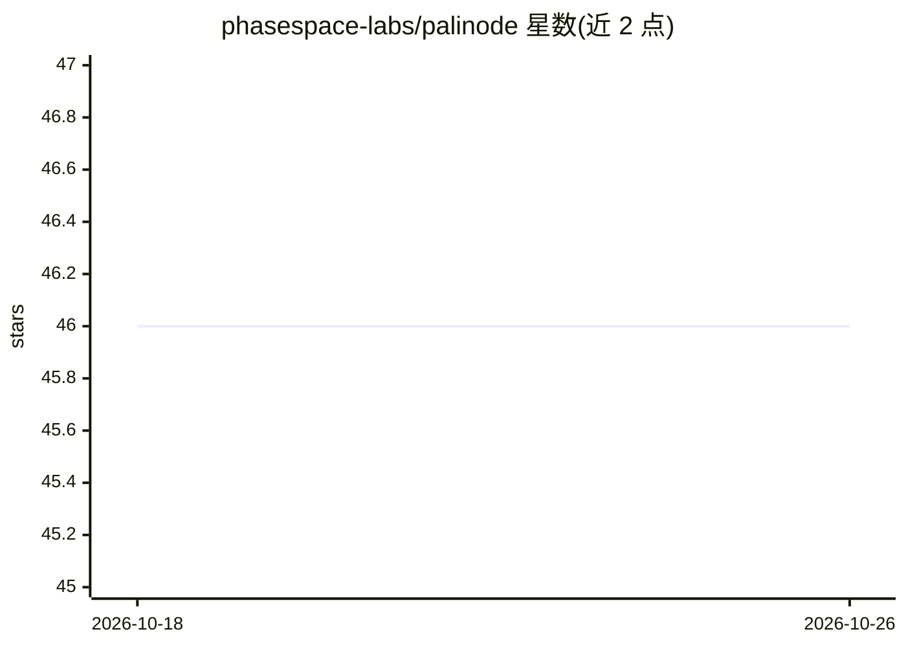

# phasespace-labs/palinode

⭐ 46 · Python · MIT · 推送 2026-10-20 · [GitHub](https://github.com/phasespace-labs/palinode) · [官网](https://phasespace.co) · 个人维护

**AI 代理项目记忆底座：Git 版本化 Markdown 记忆与 MCP 检索**

面向开发者与 AI 代理的跨会话项目记忆系统：以带 YAML frontmatter 的 Markdown 文件为唯一事实源，Git 版本化，文件监听建立 SQLite-vec 向量 + FTS5 关键词索引，提供 BM25+向量混合检索（RRF 融合）。通过 MCP 服务器、REST API、CLI 与 OpenClaw 插件四类接口访问，支持 Claude Code、Cursor、Codex 等 IDE/客户端接入；提供 git blame/diff/rollback 审计与 LLM 驱动的周期性记忆压缩（每次压缩为一个可回滚 commit）。嵌入需 Ollama bge-m3 或其他端点，v0.21 起可选纯词法模式。scope 标签不提供加密或鉴权，需自行保护存储。

## 筛选速览

| 维度 | 判定 | 备注 |
|---|---|---|
| AI 角色 | `ai-ecosystem` | LLM/agent 周边工具 |
| 许可风险 | `permissive` | MIT |
| 部署形态 | `self-host` | docker 或自建部署 |
| 模型依赖 | local-ok | 支持本地模型 |
| 硬件要求 | — | 无带数字的原话,不猜 |
| 安装摩擦 | `low` | 无编译、无系统依赖或容器化 |
| 成熟度 | — | 结构信号不足 |

## 能力要点

- Markdown 文件 + Git 历史作为记忆源，SQLite-vec + FTS5 混合索引
- MCP/REST/CLI/插件四种接口共享同一后端
- 每周 LLM 记忆压缩，每次压缩为可 review 与回滚的 git commit
- palinode blame/diff/rollback 提供记忆审计追踪

## 适用场景

- 跨会话保存并召回团队决策及其理由，避免重复旧方案
- 让 Claude Code/Cursor 等编辑器代理自动注入和捕获项目记忆
- 对记忆条目做溯源审计与错误更正

## 场景标签

`Agent 记忆` · 领域:Agent 开发

## 证据(README 行号)

> L17: Palinode keeps project memory in Markdown files and Git history under your local
> L81: |**MCP Server**|Streamable HTTP or stdio|Claude Code, Claude Desktop, Cursor, Windsurf, Zed, VS Code (Continue/Clin
> L153: Palinode speaks MCP. Follow the connection step in the

## 星数曲线

2026-10-18 46 → 2026-10-26 46（+0）

---
*卡片 v1 · prompt 1.4 · 生成 2026-10-25 · 置信度 high · 依据 README sha `c9080abc21bd` · [字段定义](../../DATASET.md)*
