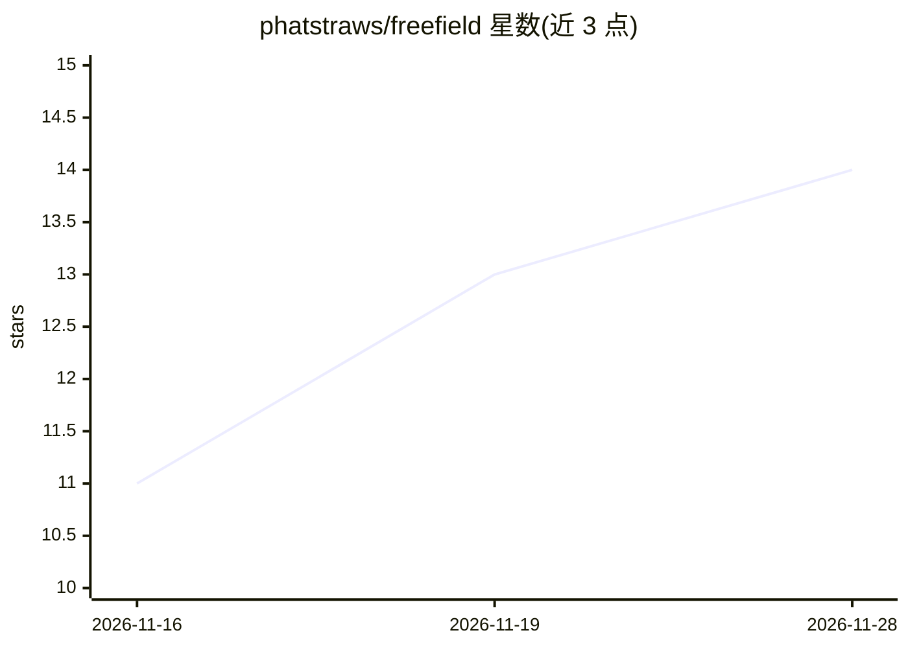

# phatstraws/freefield

⭐ 14 · Python · MIT · 推送 2026-11-16 · [GitHub](https://github.com/phatstraws/freefield) · 个人维护

**给内容创作者的开源视频特效库：一张照片一键生成可分享短片**

FreeField 将 Higgsfield 式的一键视频特效做成开放文件：每个预设是一个 ComfyUI 工作流加 preset.json 输入清单，通过 Comfy SDK 在开放权重模型（FLUX.2 klein、Wan 2.2、BiRefNet 等）上运行，自带画廊 Web 应用与命令行。每次输出经质量检查（人脸相似度、画面边缘手部、内容匹配），不通过则自动重渲染。提供约 20 个预设，含 24 GB GPU 档与 8 GB/CPU 档；自然语言构建器用固定文法（无 LLM）生成新预设。仅支持 Linux + NVIDIA GPU。

## 筛选速览

| 维度 | 判定 | 备注 |
|---|---|---|
| AI 角色 | `ai-native` | 本体是模型或模型工具 |
| 许可风险 | `permissive` | MIT |
| 部署形态 | `None` |  |
| 模型依赖 | — | README 未给出锁定关系 |
| 硬件要求 | `cpu-ok` | |
| 安装摩擦 | `medium` | 含编译或系统依赖之一 |
| 成熟度 | — | 结构信号不足 |

## 能力要点

- 预设=ComfyUI 工作流+preset.json，添加新预设只需一个文件夹、无需代码
- 每次渲染自动运行质量检查并在失败时重渲染，输出 JSON 报告
- 自然语言构建器以固定文法（无 LLM）将句子转为 ComfyUI 图
- 全部使用开放权重模型（Apache-2.0/MIT），无付费 API

## 适用场景

- 用自己的照片在本地 GPU 生成地球缩放、肖像出画等病毒式特效短片
- 为产品图生成冻结定格广告视频
- 在 ComfyUI 中复用/修改公开的特效工作流图
- 用自然语言或手工文件创建自己的特效预设

## 场景标签

`视频生成` · 领域:内容生成

## 证据(README 行号)

> L7: a single upload button, and none of it open. FreeField makes the preset an **open file**: a ComfyUI workflow plus a
> L8: `preset.json` that exposes its inputs. A gallery app and a command line run the presets on open-weights models throu
> L94: - **Checks** run on every result and trigger re-renders: likeness, "does it show what you asked for", hands or tool

## 星数曲线

2026-11-16 11 → 2026-11-28 14（+3）

---
*卡片 v1 · prompt 1.4 · 生成 2026-11-18 · 置信度 high · 依据 README sha `9829e3829b49` · [字段定义](../../DATASET.md)*
