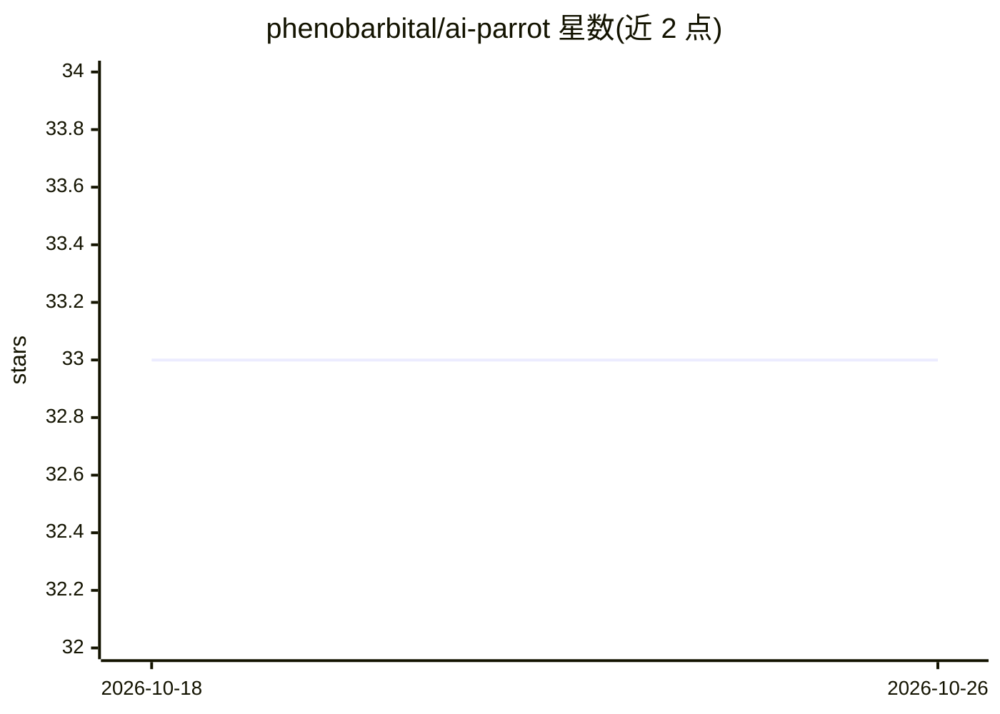

# phenobarbital/ai-parrot

⭐ 33 · Python · MIT · 推送 2026-10-25 · [GitHub](https://github.com/phenobarbital/ai-parrot) · [官网](https://phenobarbital.github.io/ai-parrot/) · 个人维护

**面向多供应商的异步 Python AI Agent 构建与编排框架**

AI-Parrot 是一个 async-first、vendor-agnostic 的 Python 框架，用于构建和编排 AI Agent 与聊天机器人。它为 OpenAI、Anthropic、Google、Groq 等提供统一客户端接口，附带 @tool 工具装饰器、30+ 工具包、AgentCrew/AgentsFlow 编排、A2A 与 MCP 协议支持，并可通过 navigator-api 生成 aiohttp 生产服务器（REST/WebSocket 端点）。采用 monorepo 结构，核心包与卫星包（tools/loaders/embeddings/integrations 等）独立发布到 PyPI，按需安装。仅支持通过 API 接入各 LLM 供应商，本身不含本地模型。

## 筛选速览

| 维度 | 判定 | 备注 |
|---|---|---|
| AI 角色 | `ai-ecosystem` | LLM/agent 周边工具 |
| 许可风险 | `permissive` | MIT |
| 部署形态 | `library` | 以包/库形式分发 |
| 模型依赖 | local-ok | 支持本地模型 |
| 硬件要求 | — | 无带数字的原话,不猜 |
| 安装摩擦 | `medium` | 含编译或系统依赖之一 |
| 成熟度 | — | 结构信号不足 |

## 能力要点

- 统一客户端接口支持 OpenAI/Anthropic/Google/Groq/OpenRouter 等多供应商
- AgentCrew（顺序/并行/流程/循环）与 AgentsFlow（事件驱动 DAG）编排
- MCP server/client 与 A2A agent 间通信支持
- parrot setup 生成 aiohttp 生产服务器（REST/WebSocket），可配 Gunicorn 部署

## 适用场景

- 用一套代码切换不同 LLM 供应商构建聊天机器人
- 构建多 agent 协作与工具调用的编排服务
- 将 agent 以 REST/WebSocket 服务形式部署上线
- 为 RAG 流水线组合文档加载与向量存储卫星包

## 场景标签

`Agent 框架` `多智能体` `RAG` · 领域:Agent 开发

## 证据(README 行号)

> L3:  The async-first, vendor-agnostic Python framework for building AI Agents.
> L12: **AI-Parrot** lets you build, extend, and orchestrate AI Agents and Chatbots without marrying yourself to a single 
> L26: - 🌐 **Speaks the protocols that matter** — native A2A agent discovery/messaging and MCP server *and* client support

## 星数曲线

2026-10-18 33 → 2026-10-26 33（+0）

---
*卡片 v1 · prompt 1.4 · 生成 2026-10-25 · 置信度 high · 依据 README sha `4ff54c472e0e` · [字段定义](../../DATASET.md)*
