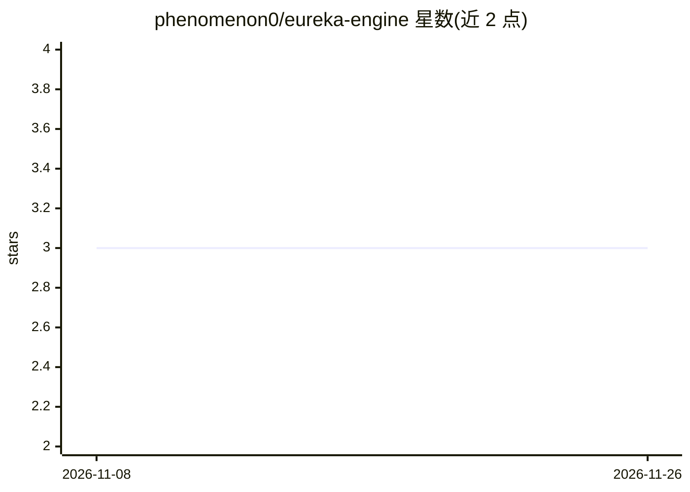

# phenomenon0/eureka-engine

⭐ 3 · C++ · Apache-2.0 · 推送 2026-11-25 · [GitHub](https://github.com/phenomenon0/eureka-engine) · 个人维护

**本地多模态 AI 引擎：聊天/视觉/语音/转录，OpenAI 兼容 API，无云**

用 Bend 语言编写的本地推理引擎，通过五个 HTTP 端点提供五类模型输出：chat（Qwen3.5 系列文本生成）、decide（带概率的标签选择）、see（D-FINE-N 目标检测）、hear（Whisper 语音转文本）、speak（Kokoro-82M 文本转语音）。支持 CUDA、Metal、iOS、Android、WebGPU 五种后端，读取 GGUF 格式模型，暴露 OpenAI 兼容 API。面向希望在自己设备上运行模型、不经云服务的用户。安装提供 Linux 安装脚本，也支持从源码构建。

## 筛选速览

| 维度 | 判定 | 备注 |
|---|---|---|
| AI 角色 | `ai-ecosystem` | LLM/agent 周边工具 |
| 许可风险 | `permissive` | Apache-2.0 |
| 部署形态 | `None` |  |
| 模型依赖 | — | README 未给出锁定关系 |
| 硬件要求 | — | 无带数字的原话,不猜 |
| 安装摩擦 | `medium` | 含编译或系统依赖之一 |
| 成熟度 | — | 结构信号不足 |

## 能力要点

- OpenAI 兼容 API 覆盖 chat/vision/speech/transcription 五类端点
- 五种后端：CUDA、Metal、iOS、Android、WebGPU
- 读取 GGUF 格式模型，含投机解码与 MoE 混合放置设计
- 以 Bend 语言实现，附带 sha256 校验的安装脚本

## 适用场景

- 在本地设备上运行聊天、目标检测、语音转写与语音合成服务
- 给现有应用接入 OpenAI 兼容 API 而不依赖云端
- 在 iPhone/Android 等移动设备上直接运行模型

## 场景标签

`推理引擎` `语音识别` `语音合成` `目标检测` · 领域:内容生成

## 证据(README 行号)

> L10:  OpenAI-compatible API
> L14:  Your models, your device, no cloud. One API for chat, vision, speech, and transcription.
> L41:  Five panels, one per verb. chat: POST /v1/chat/completions, What is the capital of France? in, Paris. out. decide:

## 星数曲线

2026-11-08 3 → 2026-11-26 3（+0）

---
*卡片 v1 · prompt 1.4 · 生成 2026-11-21 · 置信度 high · 依据 README sha `13a690a56ebb` · [字段定义](../../DATASET.md)*
