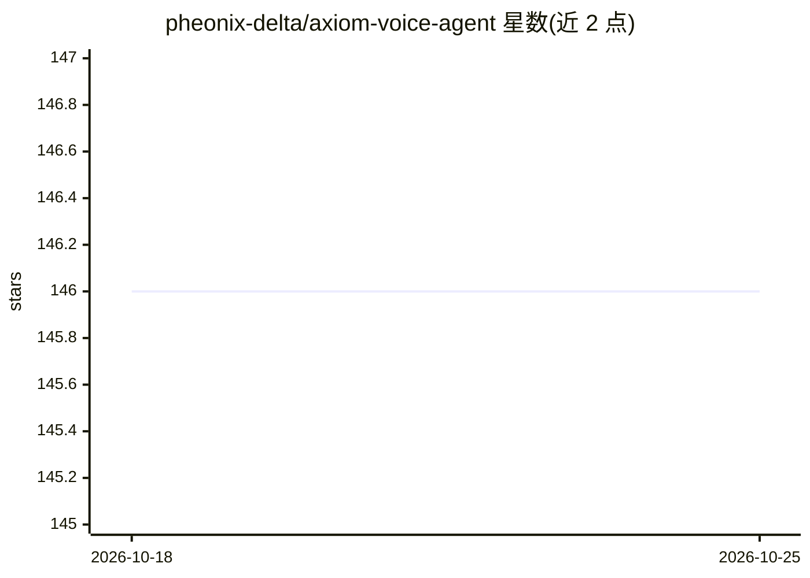

# pheonix-delta/axiom-voice-agent

⭐ 146 · Python · Apache-2.0 · 推送 2026-05-24 · [GitHub](https://github.com/pheonix-delta/axiom-voice-agent) · 个人维护

**面向机器人/边缘设备的离线低延迟语音助手**

AXIOM 是为机器人与边缘环境构建的语音代理：通过 WebSocket 实现实时语音交互，流水线由 Silero VAD 检测语音、Sherpa-ONNX 做语音识别（STT）、SetFit 分类意图、RAG 检索配合 2,116+ 模板回复，复杂查询交由 Ollama 本地模型处理，Kokoro-EN 生成语音输出。全流程离线运行，无需 API key，支持 GPU 加速（2-3.6GB VRAM）与 CPU 模式。以 Python 3.10+ / FastAPI 提供服务，克隆源码后下载模型即可在浏览器中使用。

## 筛选速览

| 维度 | 判定 | 备注 |
|---|---|---|
| AI 角色 | `ai-native` | 本体是模型或模型工具 |
| 许可风险 | `permissive` | Apache-2.0 |
| 部署形态 | `None` |  |
| 模型依赖 | local-ok | 支持本地模型 |
| 硬件要求 | `gpu-8g` | |
| 安装摩擦 | `low` | 无编译、无系统依赖或容器化 |
| 成熟度 | — | 结构信号不足 |

## 能力要点

- 端到端语音流水线：Silero VAD + Sherpa-ONNX STT + Kokoro TTS
- SetFit 意图分类使用 .safetensors，不依赖 pickle 模型头
- RAG + 2,116+ 模板回复，高置信度时绕过 LLM 节省资源
- 离线运行、无需 API key，GPU 可选（2-3.6GB VRAM）

## 适用场景

- 在边缘机器人上运行无需联网的语音交互助手
- 低显存设备（2-3.6GB VRAM）上部署本地语音代理
- 通过浏览器麦克风进行多轮语音对话与设备查询

## 场景标签

`语音 Agent` · 领域:对话与助手

## 证据(README 行号)

> L14: **AXIOM** is a voice agent built for robotics / edge environments. It combines modern ML techniques with an efficie
> L148: |**STT Handler**|Convert audio → text|Sherpa-ONNX|
> L154: |**TTS Handler**|Generate speech|Kokoro-EN (Sherpa-ONNX)|

## 星数曲线

2026-10-18 146 → 2026-10-25 146（+0）

---
*卡片 v1 · prompt 1.4 · 生成 2026-10-22 · 置信度 high · 依据 README sha `071aabde2931` · [字段定义](../../DATASET.md)*
