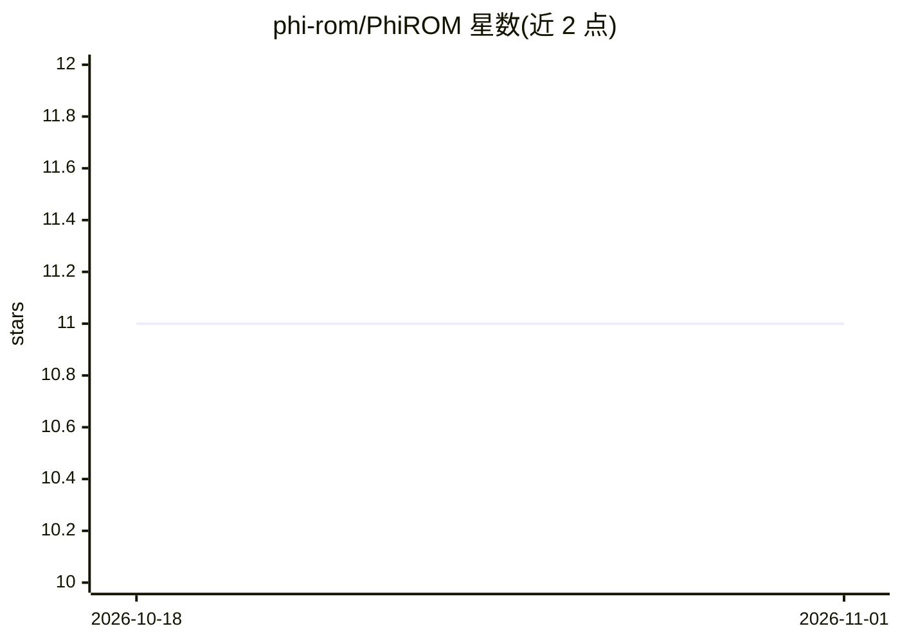

# phi-rom/PhiROM

⭐ 11 · Python · MIT · 推送 2025-11-25 · [GitHub](https://github.com/phi-rom/PhiROM) · [官网](https://phi-rom.github.io) · 组织维护

**NeurIPS 2025 论文官方实现：基于可微求解器的物理降阶模型框架**

Φ-ROM 的官方 JAX 实现：将可微 PDE 求解器（JAX-CFD、XLB、Exponax）直接纳入训练循环，学习到的潜空间动力学与离散物理保持一致；采用隐式神经表示与 Neural ODE 实现时空连续、无网格表示，支持稀疏/不规则数据训练。面向科研复现与扩展：提供数据生成、训练、评估脚本，覆盖 Burgers、Diffusion、KdV、LBM、Navier-Stokes 数据集。安装需 JAX GPU 版本（测试于 JAX 0.7.0 与 CUDA 12）、CPU 版 PyTorch（数据加载）及指定版本的 XLB。

## 筛选速览

| 维度 | 判定 | 备注 |
|---|---|---|
| AI 角色 | `ai-native` | 本体是模型或模型工具 |
| 许可风险 | `permissive` | MIT |
| 部署形态 | `library` | 以包/库形式分发 |
| 模型依赖 | — | README 未给出锁定关系 |
| 硬件要求 | — | 无带数字的原话,不猜 |
| 安装摩擦 | `medium` | 含编译或系统依赖之一 |
| 成熟度 | — | 结构信号不足 |

## 能力要点

- 可微 PDE 求解器（JAX-CFD/XLB/Exponax）直接纳入训练循环
- 基于 INR 与 Neural ODE 的时空连续、无网格表示
- 支持稀疏与不规则观测数据训练
- 提供扩展到新 PDE 与求解器的接口流程（residual 方法）

## 适用场景

- 复现论文中的降阶建模与长期预测实验
- 在 Burgers、Navier-Stokes 等 PDE 数据集上训练物理降阶模型
- 将框架扩展到自己的 PDE 与 JAX 可微求解器

## 场景标签

`科研工具` · 领域:学习与行业

## 证据(README 行号)

> L7: $\Phi$-ROM is a novel framework for creating **Physics-informed Reduced-Order Models** for time-dependent and parame
> L13: * **Physics-Informed Training**: Leverages differentiable PDE solvers (like JAX-CFD, XLB, Exponax) during training 

## 星数曲线

2026-10-18 11 → 2026-11-01 11（+0）

---
*卡片 v1 · prompt 1.4 · 生成 2026-11-01 · 置信度 high · 依据 README sha `b5e4526c1076` · [字段定义](../../DATASET.md)*
