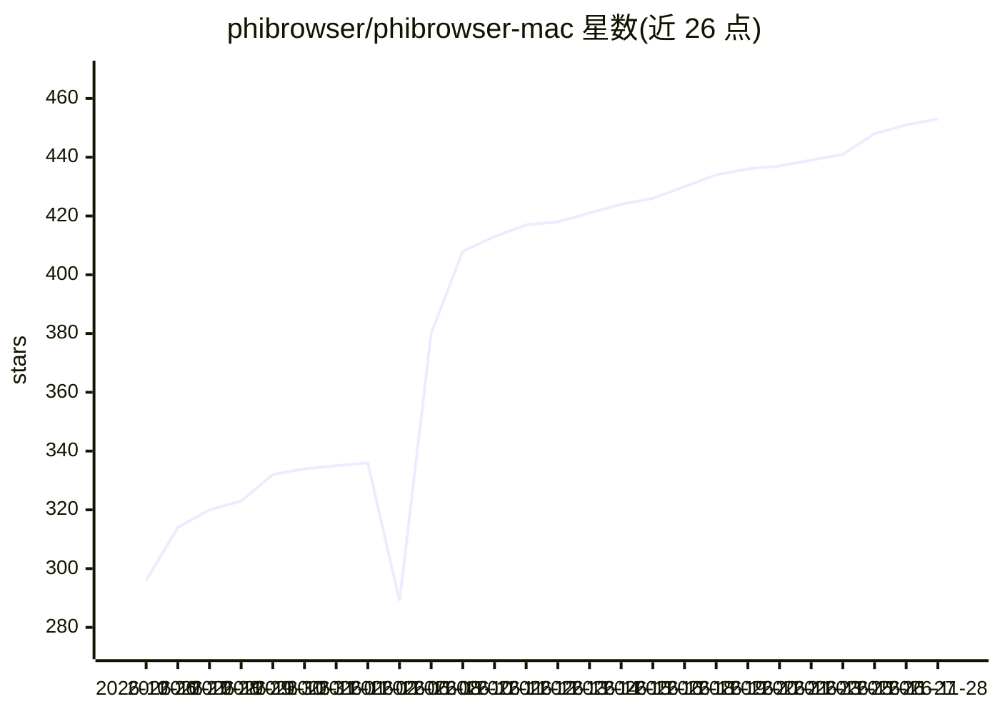

# phibrowser/phibrowser-mac

⭐ 453 · Swift · Apache-2.0 · 推送 2026-11-27 · [GitHub](https://github.com/phibrowser/phibrowser-mac) · [官网](https://phibrowser.com) · 组织维护

**本地优先、AI 可选的 macOS 原生 Chromium 浏览器**

基于自有 Chromium 构建的 macOS 原生浏览器（AppKit + SwiftUI），定位为日常浏览器，提供 Spaces、多配置、分屏、标签组、URL 规则、快捷键、画中画等功能。AI 部分可开可关：可使用自带 AI，也可经 LM Studio 或 Ollama 在本机运行自己的模型，记忆数据存于本地可读文件。源码以 Apache 2.0 发布，但浏览器引擎以二进制形式分发、AI 服务端不开源；自建版本不含 Phi 账号登录、云同步与更新器。

## 筛选速览

| 维度 | 判定 | 备注 |
|---|---|---|
| AI 角色 | `ai-enhanced` | 去掉 AI 部分产品仍成立 |
| 许可风险 | `permissive` | Apache-2.0 |
| 部署形态 | `desktop` | 安装包/桌面程序 |
| 模型依赖 | local-ok | 支持本地模型 |
| 硬件要求 | — | 无带数字的原话,不猜 |
| 安装摩擦 | `low` | 无编译、无系统依赖或容器化 |
| 成熟度 | — | 结构信号不足 |

## 能力要点

- Chromium 引擎 + AppKit/SwiftUI 的 macOS 原生应用
- AI 可选：支持经 LM Studio/Ollama 在本机运行模型，无需账号
- 记忆数据存于本地可读、可编辑、可删除的文件
- Apache 2.0 开源，支持从源码构建

## 适用场景

- 在 Mac 上使用本地优先、数据不出设备的浏览器
- 让 AI agent 驱动浏览器操作而不上传数据
- 从源码自行构建并定制浏览器

## 场景标签

`浏览器自动化` · 领域:效率与自动化

## 证据(README 行号)

> L9: Phi Browser is a Chromium-based browser built as a real native macOS app (AppKit + SwiftUI). It is a clean everyday 
> L20: - **Any AI is welcome.** Use ours. Run your own models on your own Mac with LM Studio or Ollama, no account needed.
> L31: Not all of Phi Browser is here, and we would rather point at the line than let you discover it. The browser engine 

## 星数曲线

2026-10-26 296 → 2026-11-28 453（+157）

---
*卡片 v1 · prompt 1.4 · 生成 2026-11-25 · 置信度 high · 依据 README sha `91f3281eddb0` · [字段定义](../../DATASET.md)*
