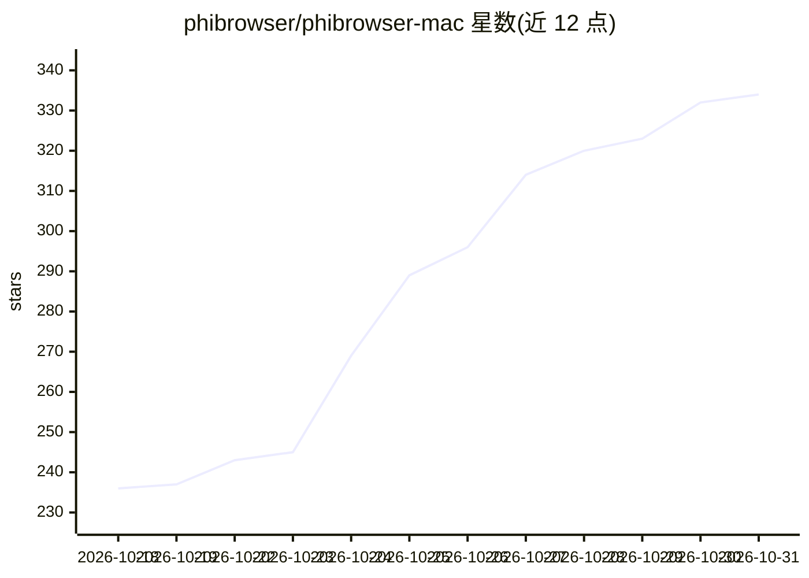

# phibrowser/phibrowser-mac

⭐ 334 · Swift · Apache-2.0 · 推送 2026-10-30 · [GitHub](https://github.com/phibrowser/phibrowser-mac) · [官网](https://phibrowser.com) · 组织维护

**macOS 原生 AI 浏览器：人与 agent 同窗共用的 Chromium 客户端**

Chromium 内核、AppKit+SwiftUI 的 macOS 原生浏览器，内置可在页面内操作的 AI agent：持久化本地记忆（文件可读可编辑）、定时任务、本地隐私防护与独立守护进程 Phi Sentinel，支持经 LM Studio/Ollama 在本机运行模型或接入 Phi Cloud，也可关闭 AI 作为普通浏览器使用。本仓库为 Apache 2.0 的 macOS 客户端源码，但 Chromium 引擎框架为闭源二进制、服务端不在开源范围内；自构建版本不接入 Phi 账号与云服务。

## 筛选速览

| 维度 | 判定 | 备注 |
|---|---|---|
| AI 角色 | `ai-enhanced` | 去掉 AI 部分产品仍成立 |
| 许可风险 | `permissive` | Apache-2.0 |
| 部署形态 | `desktop` | 安装包/桌面程序 |
| 模型依赖 | local-ok | 支持本地模型 |
| 硬件要求 | — | 无带数字的原话,不猜 |
| 安装摩擦 | `low` | 无编译、无系统依赖或容器化 |
| 成熟度 | — | 结构信号不足 |

## 能力要点

- agent 与人共用同一窗口与会话，操作记录可见
- 记忆以本地文件存储，可读、编辑、删除，官方不上传不训练
- 支持 LM Studio/Ollama 本地模型运行，或关闭 AI 作为普通浏览器
- Phi Sentinel 独立守护进程监管 AI 行为，记忆经 MCP 暴露并配 CLI

## 适用场景

- 重度浏览器使用者让 AI agent 在旁协同操作网页
- 要求模型与数据全部留在本机的隐私敏感浏览
- 把重复浏览工作流沉淀为 agent 可复用的技能

## 场景标签

`浏览器自动化` `AI 助手` · 领域:效率与自动化

## 证据(README 行号)

> L7: Phi is a Chromium-based browser built as a real native macOS app (AppKit + SwiftUI), with an AI agent that acts in t
> L19: - **Your AI, your choice of where it runs.** Point Phi at models on your own Mac or your own hardware through LM St
> L22: - **A real browser underneath.** A genuine Chromium engine with a native macOS client on top, AppKit and SwiftUI. A

## 星数曲线

2026-10-18 236 → 2026-10-31 334（+98）

---
*卡片 v1 · prompt 1.4 · 生成 2026-10-22 · 置信度 high · 依据 README sha `6187778cee61` · [字段定义](../../DATASET.md)*
