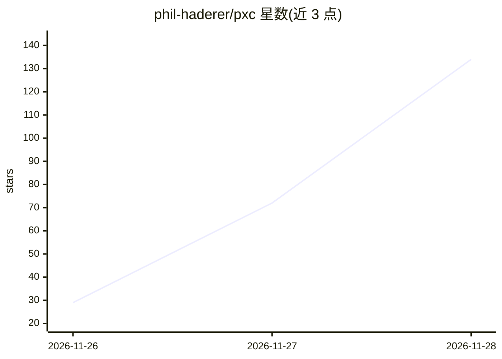

# phil-haderer/pxc

⭐ 134 · Python · Apache-2.0 · 推送 2026-11-27 · [GitHub](https://github.com/phil-haderer/pxc) · 个人维护

**PhotoCraft 伴侣应用：本地模型生成文生图与图层级图像编辑**

运行于本机的伴侣应用，衔接 PhotoCraft 图像编辑器与 ComfyUI：将用户提示词或画布选区发送给 ComfyUI 中的本地模型，生成结果以新图层返回文档。支持文生图、扩展、填充、移除、编辑、精修、放大七种模式，内置 7 个模型的一键下载与目录归位，含提示词改进 LLM、83+34 个风格提示词模板，并支持多台客户端共用一个 ComfyUI 服务端。要求 PhotoCraft 0.20.2–0.23.1、约 8 GB 显存，每模型需 13–38 GB 磁盘空间。

## 筛选速览

| 维度 | 判定 | 备注 |
|---|---|---|
| AI 角色 | `ai-native` | 本体是模型或模型工具 |
| 许可风险 | `permissive` | Apache-2.0 |
| 部署形态 | `desktop` | 安装包/桌面程序 |
| 模型依赖 | — | README 未给出锁定关系 |
| 硬件要求 | `gpu-8g` | |
| 安装摩擦 | `low` | 无编译、无系统依赖或容器化 |
| 成熟度 | `idea` | |

## 能力要点

- 七种生成模式：文生图/扩展/填充/移除/编辑/精修/放大，结果以新图层返回
- 7 个本地模型一键下载并自动放入 ComfyUI 对应目录，支持 bf16/fp8/nvfp4/GGUF 自选文件
- 内置 LLM 功能：改进提示词、描述画布与参考图、草图转提示词
- 团队用法：多台 PxC 指向同一 ComfyUI 服务端，队列可见他人任务

## 适用场景

- 在 PhotoCraft 中用本地模型做选区填充、物体移除与画布扩展
- 无网络依赖地生成图像并将结果直接作为图层继续编辑
- 小团队共用一台 GPU 机器跑 ComfyUI 推理队列

## 场景标签

`图像生成` · 领域:内容生成

## 证据(README 行号)

> L7: **A companion app that brings Photoshop-style generative AI to PhotoCraft, running on your own PC.**
> L8: Pick a function, type a prompt, press Generate: the result arrives as a new layer in your document.
> L97: - **ComfyUI** runs the AI models on your graphics card.

## 星数曲线

2026-11-26 29 → 2026-11-28 134（+105）

---
*卡片 v1 · prompt 1.4 · 生成 2026-11-28 · 置信度 mid · 依据 README sha `2143d8063341` · [字段定义](../../DATASET.md)*
