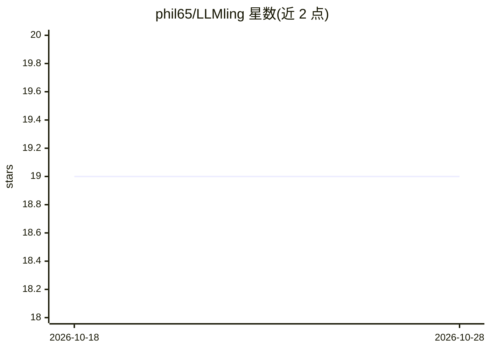

# phil65/LLMling

⭐ 19 · Python · MIT · 推送 2025-12-09 · [GitHub](https://github.com/phil65/LLMling) · 个人维护

**YAML 声明式定义 MCP 服务器与 AI Agent 的 Python 框架**

面向 LLM 应用开发的框架：通过 YAML 配置声明资源（文件/文本/CLI 输出等内容提供者）、提示模板与工具，无代码即可搭建 MCP 服务器，为两个消费者提供后端——MCP 服务器与基于 pydantic-AI 的 Agent。支持资源分组、文件监视、处理器流水线、函数式/类式工具、工具集扩展点、OpenAPI 端点接入与工具进度上报。提供 CLI 管理配置；可在 Zed、Claude Desktop 等客户端中作为 context server 接入。要求 Python 3.12+，基于 pydantic，全部类型注解。文末更多文档自述多为 AI 生成且过时。

## 筛选速览

| 维度 | 判定 | 备注 |
|---|---|---|
| AI 角色 | `ai-ecosystem` | LLM/agent 周边工具 |
| 许可风险 | `permissive` | MIT |
| 部署形态 | `library` | 以包/库形式分发 |
| 模型依赖 | — | README 未给出锁定关系 |
| 硬件要求 | — | 无带数字的原话,不猜 |
| 安装摩擦 | `low` | 无编译、无系统依赖或容器化 |
| 成熟度 | — | 结构信号不足 |

## 能力要点

- YAML 声明资源/提示/工具，无代码定义 LLM 环境
- 基于 MCP 协议，可接入 Zed / Claude Desktop
- 函数式与类式工具、工具集（含 OpenAPI 端点、扩展点系统）
- 资源处理器流水线与文件变更监视

## 适用场景

- 用 YAML 快速搭建自定义 MCP 服务器
- 为 LLM Agent 统一声明资源、提示与工具
- 把 OpenAPI 端点或 Python 函数暴露为 LLM 可调用工具

## 场景标签

`Agent 框架` · 领域:Agent 开发

## 证据(README 行号)

> L26: A framework for declarative LLM application development focused on resource management, prompt templates, and tool 
> L28: This package provides the backend for two consumers: A MCP server and a pydantic-AI based Agent
> L36: - **MCP Protocol**: Built on the Machine Chat Protocol (MCP) for standardized LLM interaction

## 星数曲线

2026-10-18 19 → 2026-10-28 19（+0）

---
*卡片 v1 · prompt 1.4 · 生成 2026-10-28 · 置信度 high · 依据 README sha `279aa53b26a3` · [字段定义](../../DATASET.md)*
