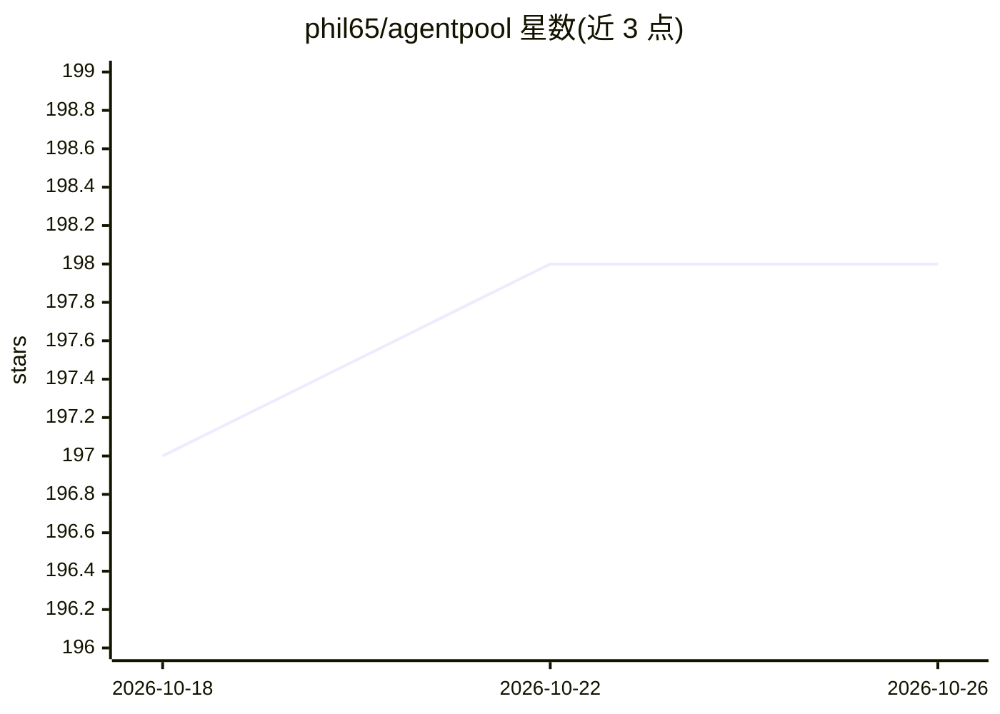

# phil65/agentpool

⭐ 198 · Python · MIT · 推送 2026-04-25 · [GitHub](https://github.com/phil65/agentpool) · [官网](https://phil65.github.io/agentpool/) · 个人维护

**用 YAML 统一编排多 AI agent 并以标准协议暴露的枢纽**

AgentPool 是一个 agent 编排中心：在单个 YAML 文件中定义原生（基于 PydanticAI）、直连集成（Claude Code、Codex）、外部 ACP agent（如 Goose）及 AG-UI agent，再通过 ACP、OpenCode、MCP、AG-UI 或 OpenAI API 协议统一暴露，使不同 agent 之间可协作、委派与通信。支持 agent 组队（并行）与链式（串行）执行、结构化输出、存储分析、远程文件抽象、文件/webhook 触发器与流式 TTS。通过 uv/PyPI 安装，提供 CLI 与 Python API。

## 筛选速览

| 维度 | 判定 | 备注 |
|---|---|---|
| AI 角色 | `ai-ecosystem` | LLM/agent 周边工具 |
| 许可风险 | `permissive` | MIT |
| 部署形态 | `library` | 以包/库形式分发 |
| 模型依赖 | — | README 未给出锁定关系 |
| 硬件要求 | — | 无带数字的原话,不猜 |
| 安装摩擦 | `low` | 无编译、无系统依赖或容器化 |
| 成熟度 | — | 结构信号不足 |

## 能力要点

- 单个 YAML 配置管理原生、ACP、AG-UI、Claude Code 等异构 agent
- 通过 ACP/OpenCode/MCP/AG-UI/OpenAI API 五种协议暴露 agent
- agent 团队并行与链式执行，支持委派与通信
- 结构化输出、交互分析、触发器与流式 TTS

## 适用场景

- 在同一入口下混合使用 Claude Code、Codex、Goose 等多种 agent
- 在 Zed 等 IDE 中通过 ACP 协议调用统一管理的 agent
- 构建串行/并行的多 agent 处理流水线
- 以 OpenAI API 兼容接口替换方式暴露自建 agent

## 场景标签

`多智能体` `Agent 框架` · 领域:Agent 开发

## 证据(README 行号)

> L9: **A unified agent orchestration hub that lets you configure and manage heterogeneous AI agents via YAML and expose t
> L19: AgentPool acts as a protocol bridge. Define all your agents in one YAML file - whether they're native (PydanticAI-b
> L100: AgentPool can expose your agents through multiple server protocols:

## 星数曲线

2026-10-18 197 → 2026-10-26 198（+1）

---
*卡片 v1 · prompt 1.4 · 生成 2026-10-22 · 置信度 high · 依据 README sha `b06ebb5acd67` · [字段定义](../../DATASET.md)*
