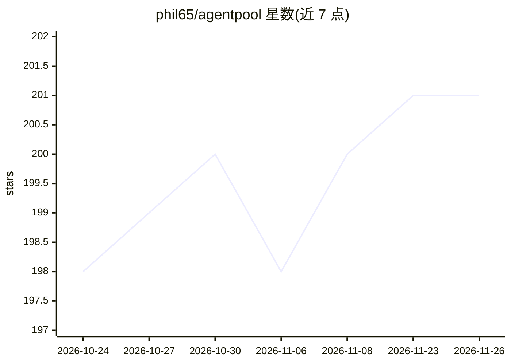

# phil65/agentpool

⭐ 201 · Python · MIT · 推送 2026-11-25 · [GitHub](https://github.com/phil65/agentpool) · [官网](https://phil65.github.io/agentpool/) · 个人维护

**多 AI agent 的统一编排枢纽：YAML 配置、标准协议暴露**

以协议桥形式工作：用户在单个 YAML 文件中定义异构 agent（基于 PydanticAI 的原生 agent、Claude Code/Codex 直接集成、外部 ACP agent、AG-UI agent），随后统一通过 ACP、OpenCode、MCP、AG-UI 或 OpenAI 兼容 API 等服务协议暴露，使 agent 可协作、委派与通信。支持团队（并行）与链（串行）编排、结构化输出、存储与分析、文件触发器、流式 TTS。经 uv 安装，提供 CLI 与 Python API 两种使用方式。

## 筛选速览

| 维度 | 判定 | 备注 |
|---|---|---|
| AI 角色 | `ai-ecosystem` | LLM/agent 周边工具 |
| 许可风险 | `permissive` | MIT |
| 部署形态 | `library` | 以包/库形式分发 |
| 模型依赖 | — | README 未给出锁定关系 |
| 硬件要求 | — | 无带数字的原话,不猜 |
| 安装摩擦 | `low` | 无编译、无系统依赖或容器化 |
| 成熟度 | — | 结构信号不足 |

## 能力要点

- YAML 单文件配置异构 agent（原生 PydanticAI、Claude Code、Codex、Goose、AG-UI）
- 多协议服务端：ACP、OpenCode、MCP、AG-UI、OpenAI 兼容 API
- agent 团队（并行）与链（串行）编排及跨 agent 委派
- 存储分析、文件/webhook 触发器与流式 TTS

## 适用场景

- 在 IDE（如 Zed、Toad）中通过 ACP 接入统一管理的多个 agent
- 让一个协调 agent 把任务委派给不同类型的 agent
- 用 OpenAI 兼容 API 替换方式对外暴露已有 agent

## 场景标签

`模型网关` `多智能体` · 领域:Agent 开发

## 证据(README 行号)

> L9: **A unified agent orchestration hub that lets you configure and manage heterogeneous AI agents via YAML and expose t
> L21: AgentPool acts as a protocol bridge. Define all your agents in one YAML file - whether they're native (PydanticAI-b
> L108: |**ACP**|`agentpool serve-acp`|IDE integration (Zed, Toad) - bidirectional communication with tool confirmations|

## 星数曲线

2026-10-24 198 → 2026-11-26 201（+3）

---
*卡片 v1 · prompt 1.4 · 生成 2026-11-25 · 置信度 high · 依据 README sha `67871bb370b3` · [字段定义](../../DATASET.md)*
