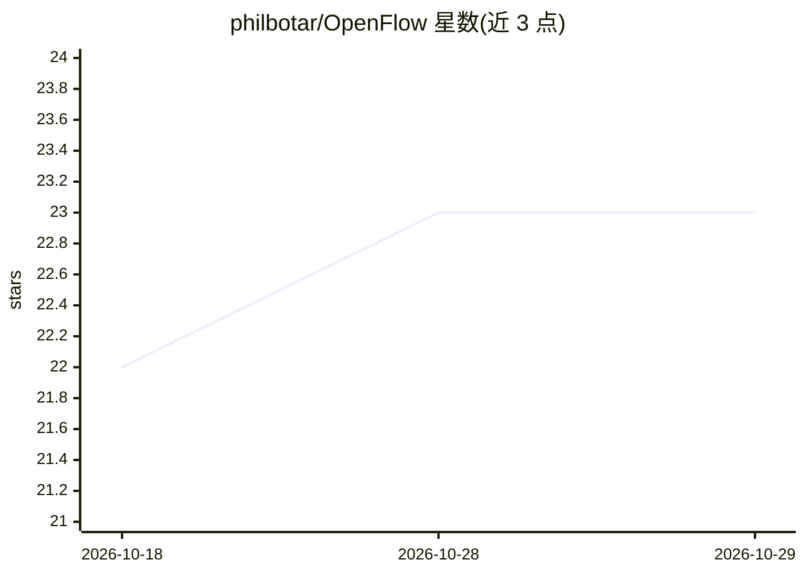

# philbotar/OpenFlow

⭐ 23 · Rust · MIT · 推送 2026-10-24 · [GitHub](https://github.com/philbotar/OpenFlow) · [官网](https://philbotar.github.io/OpenFlow/) · 个人维护

**桌面多智能体工作流编排器：可视化构建并运行 agent 流程**

基于 Tauri 2 + Rust + SolidJS 的桌面应用，提供画布编辑器用于搭建多 agent 工作流：节点可并行执行、支持依赖与交接、逐节点指定模型。内置文件、Shell、搜索、MCP 等工具及审批模式（human-in-the-loop），运行后给出改进建议。支持 OpenAI、Anthropic、Bedrock、DeepSeek 等托管商，本地可经 Ollama 或 LM Studio 运行。从 Releases 下载即用，无需预装。

## 筛选速览

| 维度 | 判定 | 备注 |
|---|---|---|
| AI 角色 | `ai-ecosystem` | LLM/agent 周边工具 |
| 许可风险 | `permissive` | MIT |
| 部署形态 | `desktop` | 安装包/桌面程序 |
| 模型依赖 | local-ok | 支持本地模型 |
| 硬件要求 | — | 无带数字的原话,不猜 |
| 安装摩擦 | `low` | 无编译、无系统依赖或容器化 |
| 成熟度 | — | 结构信号不足 |

## 能力要点

- 画布编辑器构建多 agent 工作流，同层节点并行执行
- 逐节点选用不同提供商的模型，支持依赖与交接
- 内置工具（文件/Shell/搜索/MCP）与工具调用审批模式
- 支持 Ollama / LM Studio 本地模型与 OpenAI 兼容自定义端点

## 适用场景

- 把规划、实现、代码审查、测试 agent 串成可视化流水线
- 让多个专业 agent 并行做调研再汇总结论
- 在 agent 执行命令前暂停等待人工批准

## 场景标签

`多智能体` · 领域:Agent 开发

## 证据(README 行号)

> L5:  Agent harness for creating multi-agent workflows
> L7:  Design workflows where different provider agents can work autonomously or with human intervention, with defined han

## 星数曲线

2026-10-18 22 → 2026-10-29 23（+1）

---
*卡片 v1 · prompt 1.4 · 生成 2026-10-27 · 置信度 high · 依据 README sha `7e83be4d24a5` · [字段定义](../../DATASET.md)*
