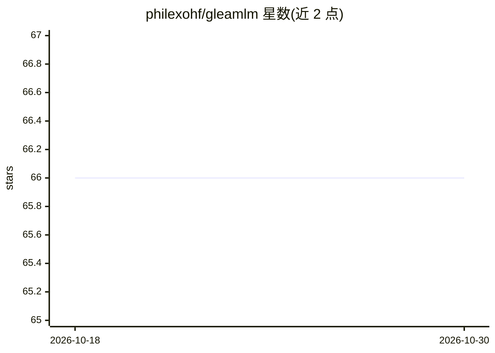

# philexohf/gleamlm

⭐ 66 · Python · Apache-2.0 · 推送 2026-09-18 · [GitHub](https://github.com/philexohf/gleamlm) · 个人维护 · 中文 README

**从零实现的大语言模型全栈训练平台，双轨设计，12GB 显卡可训**

GleamLM 是覆盖数据管道、自研 BBPE 分词器、模型架构、预训练与后训练（SFT/DPO/PPO/GRPO/OPD/LoRA）及推理服务的全栈 LLM 训练平台，面向预训练与后训练工程师。采用双轨设计：手写轨基于 PyTorch 从零实现核心算法（GQA、RoPE、QK-Norm、Mamba 等），工业轨对接 Megatron/TRL/PEFT/DeepSpeed，两轨消费同一份数据可逐层对照。提供 CLI 与浏览器可视化训练控制台（WebUI），推理侧支持 vLLM 部署与 OpenAI 兼容 API。限制：MoE/Mamba 等为教学实现未在成品配置启用，多卡全量训练尚未验证。核心库已发布 PyPI。

## 筛选速览

| 维度 | 判定 | 备注 |
|---|---|---|
| AI 角色 | `ai-ecosystem` | LLM/agent 周边工具 |
| 许可风险 | `permissive` | Apache-2.0 |
| 部署形态 | `library` | 以包/库形式分发 |
| 模型依赖 | local-ok | 支持本地模型 |
| 硬件要求 | `gpu-8g` | |
| 安装摩擦 | `medium` | 含编译或系统依赖之一 |
| 成熟度 | `idea` | |

## 能力要点

- 手写轨与工业轨（Megatron/TRL/PEFT/DeepSpeed）消费同一份数据逐层对照
- 单卡 12GB 显存即可完整训练 Nano/Lite（40M/87M）规格模型
- 浏览器 WebUI 任务卡一键启动各训练阶段，实时曲线与 checkpoint 对话
- 预训练数据 4.47B tokens 四源配比，已上传 ModelScope 供复现

## 适用场景

- 我想在消费级显卡上完整走一遍 LLM 预训练到对齐的全链路
- 对比手写实现与工业框架，理解训练各层的原理与工程差异
- 用可视化控制台管理与监控多个训练实验

## 场景标签

`模型训练` `微调` `强化学习` · 领域:训练与推理

## 证据(README 行号)

> L3: GleamLM 是一套从零实现的 LLM 工程实践项目，覆盖数据管道、BBPE 分词器、模型架构、预训练与后训练，以及推理服务全流程。平台采用双轨设计，手写轨基于 PyTorch 从零实现核心算法，工业轨兼容 Hugging Fac
> L18: GleamLM 面向大语言模型预训练与后训练工程师，目标是理解原理和工业实战。
> L28: 掌握标准工业框架的使用：Megatron做预训练、TRL 做 DPO/GRPO、PEFT 做 LoRA、vLLM 做部署。对接工业界实际使用的工具链，直接进团队协作流程。

## 星数曲线

2026-10-18 66 → 2026-10-30 66（+0）

---
*卡片 v1 · prompt 1.4 · 生成 2026-10-24 · 置信度 high · 依据 README sha `d5ecf0ed75e0` · [字段定义](../../DATASET.md)*
