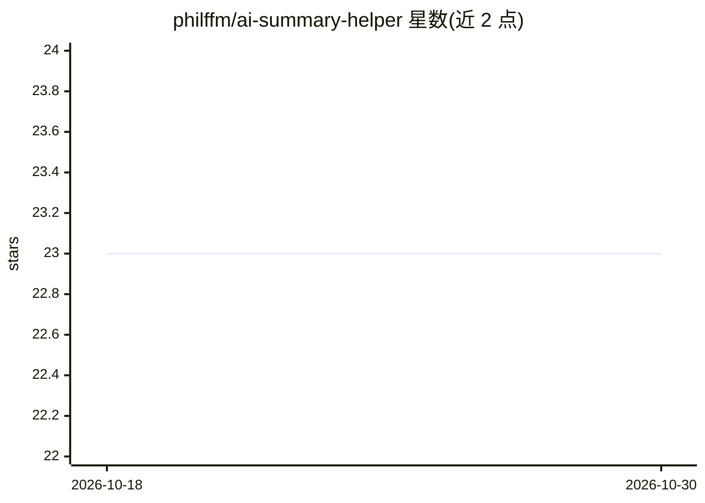

# philffm/ai-summary-helper

⭐ 23 · JavaScript · MIT · 推送 2026-10-27 · [GitHub](https://github.com/philffm/ai-summary-helper) · [官网](https://ai-summary-helper.byphil.eu/) · 个人维护

**浏览器扩展：用自有 Key 或本地模型总结网页/PDF/YouTube**

MIT 许可的浏览器扩展与书签小程序，在浏览器侧边栏中总结网页、PDF 与 YouTube 视频字幕，支持 41 种输出语言。可用自带 API Key（OpenAI、Gemini、Mistral、DeepSeek）、本地 Ollama，或免 Key 的 byphil Cloud（含少量免费额度与 Pro 计划）。阅读库、高亮与统计存储在浏览器本地，页面文本仅发往所选 provider。内置 RSS 阅读器、设备端全文检索、知识图谱、科研论文研究模式，并支持导出到 Kindle/Obsidian/LocalSend。提供 Chrome 商店安装与多浏览器源码构建方式。

## 筛选速览

| 维度 | 判定 | 备注 |
|---|---|---|
| AI 角色 | `ai-native` | 本体是模型或模型工具 |
| 许可风险 | `permissive` | MIT |
| 部署形态 | `None` |  |
| 模型依赖 | local-ok | 支持本地模型 |
| 硬件要求 | — | 无带数字的原话,不猜 |
| 安装摩擦 | `low` | 无编译、无系统依赖或容器化 |
| 成熟度 | — | 结构信号不足 |

## 能力要点

- 支持自有 Key（OpenAI/Gemini/Mistral/DeepSeek）与本地 Ollama，库与高亮存于浏览器
- 41 种总结语言、14 种界面语言
- 内置 RSS 阅读器、设备端 TF-IDF 全文检索与知识图谱
- 2.2 研究模式：识别科研论文并从 DOI 注册表生成引用
- 支持发送到 Kindle、LocalSend、Obsidian 与 Markdown 导出

## 适用场景

- 在浏览器侧边栏快速总结文章、PDF 和 YouTube 视频
- 用本地 Ollama 模型做不外发数据的摘要
- 通过内置 RSS 阅读器跟踪站点并归档检索阅读历史
- 整理科研论文集合并生成引用

## 场景标签

`AI 写作` `科研工具` · 领域:内容生成

## 证据(README 行号)

> L13:  A free, open-source browser extension that summarizes web pages, PDFs and YouTube videos in 41 languages, with you
> L17: **AI Summary Helper** (AISH) turns that pile into a reading habit. It gives you a short overview of any article, PD

## 星数曲线

2026-10-18 23 → 2026-10-30 23（+0）

---
*卡片 v1 · prompt 1.4 · 生成 2026-10-27 · 置信度 high · 依据 README sha `fa7b8401a786` · [字段定义](../../DATASET.md)*
