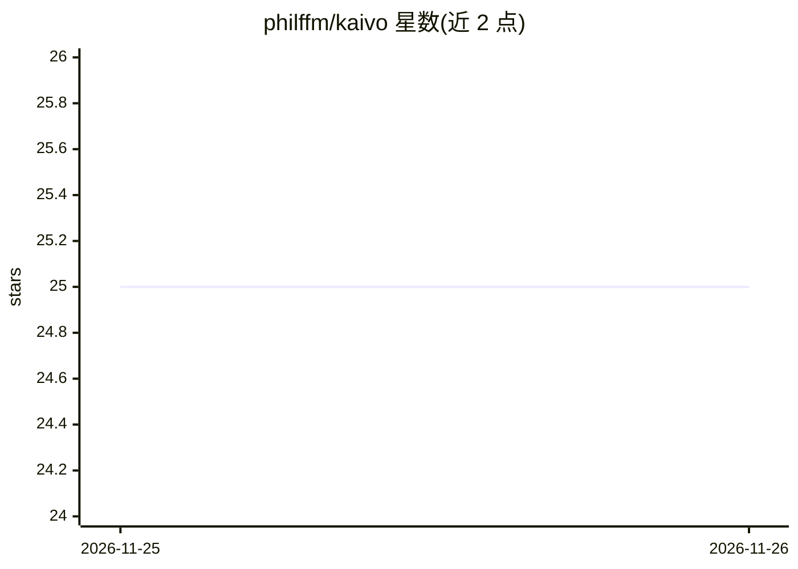

# philffm/kaivo

⭐ 25 · JavaScript · AGPL-3.0 · 推送 2026-11-25 · [GitHub](https://github.com/philffm/kaivo) · [官网](http://kaivo.byphil.eu/) · 个人维护

**浏览器阅读助手：本地或自选模型总结网页/PDF/YouTube**

以浏览器扩展（Chrome Web Store、Firefox/Safari 构建）和书签脚本两种形态分发，对网页、PDF、YouTube 视频生成 41 种语言的摘要，摘要与追问在侧边栏呈现。模型来源支持自带 API key 或经 Ollama 本地运行；追问答案引用出处段落，不在原文中的引语被丢弃。内置 RSS 阅读器、全文本检索、知识图谱、笔记高亮、库同步（Nextcloud/WebDAV/S3/本地文件夹）及发送到 Kindle（经 byPhil 后端）或 LocalSend（P2P 直传）。

## 筛选速览

| 维度 | 判定 | 备注 |
|---|---|---|
| AI 角色 | `ai-native` | 本体是模型或模型工具 |
| 许可风险 | `dual` | AGPL-3.0 |
| 部署形态 | `None` |  |
| 模型依赖 | local-ok | 支持本地模型 |
| 硬件要求 | — | 无带数字的原话,不猜 |
| 安装摩擦 | `low` | 无编译、无系统依赖或容器化 |
| 成熟度 | — | 结构信号不足 |

## 能力要点

- 支持自带 key（OpenAI/Gemini/Mistral/DeepSeek）或 Ollama 本地模型，无需账号
- 追问答案引用出处段落，非原文引语被丢弃
- 研究模式识别科学论文，提取设计与资助信息并从 DOI 注册库构建引文
- 库同步/备份/发布基于用户自有存储（Nextcloud、S3、本地文件夹），浏览器端加密

## 适用场景

- 整理积压的网页标签页，生成摘要后归档或发送到 Kindle 稍后阅读
- 在本地运行 Ollama 模型，不把页面文本发送到云端
- 用 RSS 阅读器跟进站点并生成带来源的每日简报
- 管理科学论文阅读集合并生成引文

## 场景标签

`知识库管理` `知识图谱` · 领域:知识与检索

## 证据(README 行号)

> L13:  A free, open-source browser extension that summarizes web pages, PDFs and YouTube videos in 41 languages, with you
> L17: **Kaivo** (formerly *AI Summary Helper*, same extension, same data) turns that pile into a reading habit. It gives 
> L50: - **Summaries of pages, PDFs and YouTube videos.** With your model: the byphil Cloud gives you access to most LLMs 

## 星数曲线

2026-11-25 25 → 2026-11-26 25（+0）

---
*卡片 v1 · prompt 1.4 · 生成 2026-11-24 · 置信度 high · 依据 README sha `a415328e1a5c` · [字段定义](../../DATASET.md)*
