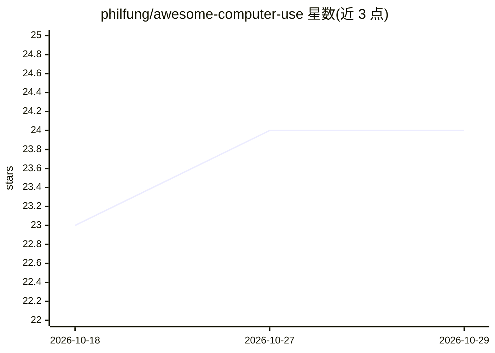

# philfung/awesome-computer-use

⭐ 24 · 推送 2026-10-26 · [GitHub](https://github.com/philfung/awesome-computer-use) · 个人维护

**LLM 驱动 GUI computer-use 的论文与库策展清单**

由个人维护的精选清单，收录与 LLM 操作图形界面（computer use）相关的资源，分为 Demos、Frameworks、Papers、Talks 四部分。框架条目涵盖 macOS 语音/视觉代理、Windows 计算机使用代理、iPhone 硬件代理、浏览器自动化等；论文条目覆盖 2023-2026 年间的基准（OSWorld、ClawBench）、模型（CogAgent、Ferret-UI）与训练方法（WebRL）等。README 自述立场鲜明、重质不重量，不提供安装或运行方式。

## 筛选速览

| 维度 | 判定 | 备注 |
|---|---|---|
| AI 角色 | `ai-knowledge` | 知识聚合/清单类 |
| 许可风险 | `none` | — |
| 部署形态 | `None` |  |
| 模型依赖 | — | README 未给出锁定关系 |
| 硬件要求 | — | 无带数字的原话,不猜 |
| 安装摩擦 | `low` | 无编译、无系统依赖或容器化 |
| 成熟度 | — | 结构信号不足 |

## 能力要点

- 按 Demos/Frameworks/Papers/Talks 四类组织条目
- 收录学术机构（Stanford、Tsinghua、UBC、HKU 等）与企业（Microsoft、Apple、Anthropic）的论文
- 框架条目标注许可证与运行平台（macOS/Windows/iOS 等）

## 适用场景

- 查找 LLM 驱动 GUI 自动化的开源框架与代理项目
- 按时间线了解 computer-use 领域的论文脉络
- 为 RPA 或 GUI agent 选型调研候选工具

## 场景标签

`精选清单` · 领域:学习与行业

## 证据(README 行号)

> L2: Curated list of papers + libraries related to computer GUI use via LLMs.\
> L10: ## Frameworks

## 星数曲线

2026-10-18 23 → 2026-10-29 24（+1）

---
*卡片 v1 · prompt 1.4 · 生成 2026-10-27 · 置信度 high · 依据 README sha `54fa50e04f59` · [字段定义](../../DATASET.md)*
