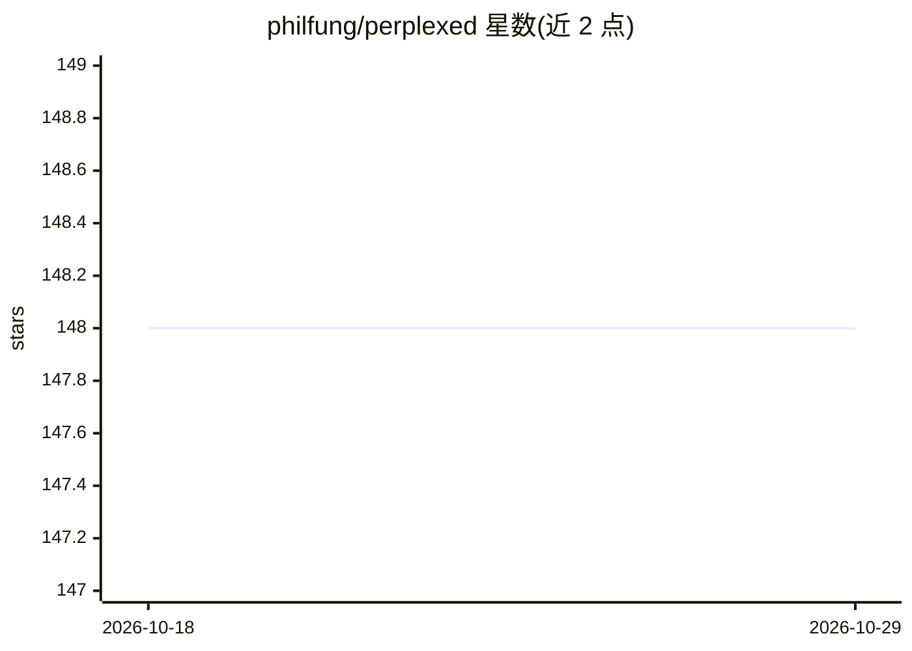

# philfung/perplexed

⭐ 148 · Python · MIT · 推送 2025-11-19 · [GitHub](https://github.com/philfung/perplexed) · [官网](https://philfung.github.io/perplexed) · 个人维护

**开源 Perplexity 式 AI 网页搜索问答应用**

受 Perplexity 启发的开源 Web 应用：接收用户查询后执行网页搜索，下载排名前 N 的结果页面，再由 LLM 分析这些页面生成回答；可使用任意具备至少 5k 上下文窗口的消费级小模型。架构为 Python 后端加前端两部分，检索依赖 Google Custom Search API，LLM 通过 Groq API 接入；提供 dev/staging/production 三种运行模式，可用 justfile 脚本或手动部署，staging/production 以 Docker 容器加 nginx 运行，部署前需填写 .env 环境变量与 API 凭证。

## 筛选速览

| 维度 | 判定 | 备注 |
|---|---|---|
| AI 角色 | `ai-native` | 本体是模型或模型工具 |
| 许可风险 | `permissive` | MIT |
| 部署形态 | `self-host` | docker 或自建部署 |
| 模型依赖 | locked-api |  |
| 硬件要求 | — | 无带数字的原话,不猜 |
| 安装摩擦 | `low` | 无编译、无系统依赖或容器化 |
| 成熟度 | — | 结构信号不足 |

## 能力要点

- 查询→网页搜索→下载前 N 页→LLM 分析的流程
- 支持任意 ≥5k 上下文窗口的消费级小模型
- dev/staging/production 三模式，Docker 容器加 nginx 部署
- justfile 脚本化构建与运行流程

## 适用场景

- 自部署一个 Perplexity 式的网页搜索问答服务
- 用小参数本地/消费级模型搭建低成本的搜索增强问答
- 学习搜索+LLM 应用的前后端部署结构

## 场景标签

`RAG` · 领域:知识与检索

## 证据(README 行号)

> L13: Given a user query, the app conducts a web search,
> L14: downloads the top N resulting web pages, then analyzes those pages
> L15: with an LLM.

## 星数曲线

2026-10-18 148 → 2026-10-29 148（+0）

---
*卡片 v1 · prompt 1.4 · 生成 2026-10-23 · 置信度 mid · 依据 README sha `be50299ad55d` · [字段定义](../../DATASET.md)*
