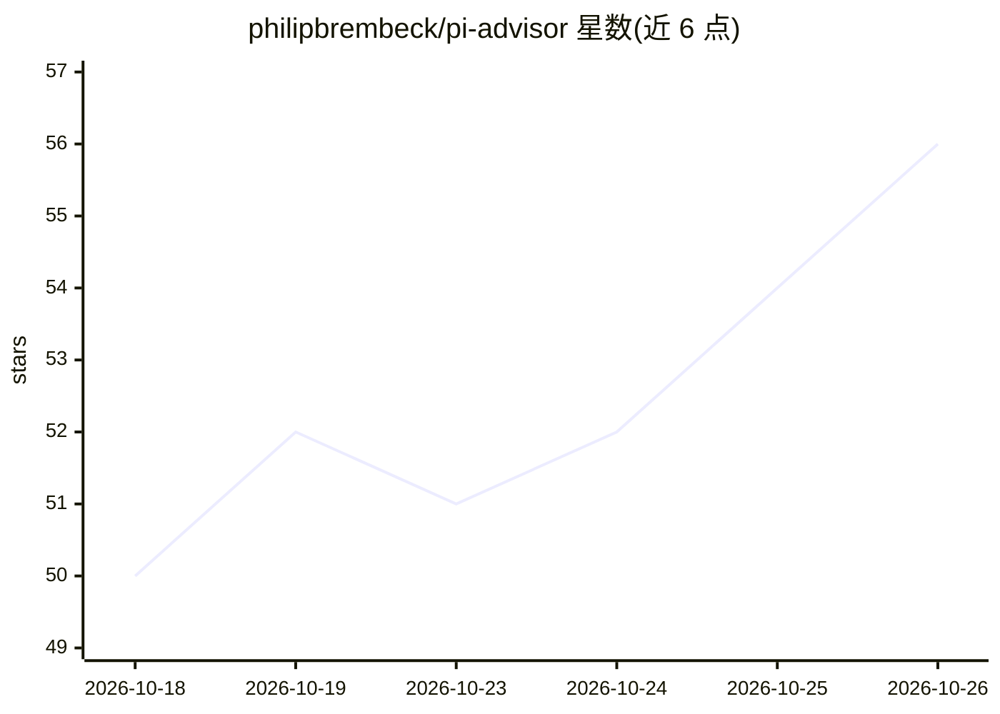

# philipbrembeck/pi-advisor

⭐ 56 · TypeScript · MIT · 推送 2026-10-22 · [GitHub](https://github.com/philipbrembeck/pi-advisor) · [官网](https://www.npmjs.com/package/pi-advisor-flow) · 个人维护

**Pi 编程 Agent 的第二意见工作流插件：执行/顾问双模型分工**

面向 Pi Coding Agent 的可配置扩展：Executor 模型负责执行任务，另一个 Advisor 模型在关键决策、反复失败和最终评审时提供第二意见，通过 ask_advisor 工具与 /advisor 系列命令触发。提供评审门控、循环检测、模型白名单、回退模型、用量计费统计与隐私控制（历史/仓库上下文/密钥脱敏）。需 Pi 1.0.0+，经 pi install 安装，另含可选的 Jev 分类器筛选与 Codemode 集成。

## 筛选速览

| 维度 | 判定 | 备注 |
|---|---|---|
| AI 角色 | `ai-ecosystem` | LLM/agent 周边工具 |
| 许可风险 | `permissive` | MIT |
| 部署形态 | `library` | 以包/库形式分发 |
| 模型依赖 | — | README 未给出锁定关系 |
| 硬件要求 | — | 无带数字的原话,不猜 |
| 安装摩擦 | `low` | 无编译、无系统依赖或容器化 |
| 成熟度 | `idea` | |

## 能力要点

- Executor/Advisor 双模型分离，同模型咨询默认跳过
- 评审门控与重复工具调用循环检测
- 模型白名单、回退模型与调用预算记账
- 隐私控制：仓库上下文、密钥脱敏、结果记录可选

## 适用场景

- 让快模型执行、强模型只在关键决策时介入的编码工作流
- 在多次失败或完成前触发模型自查评审
- 统计顾问建议的采纳率与验证通过率

## 场景标签

`编码 Agent` `代码审查` · 领域:编码与开发

## 证据(README 行号)

> L5: A configurable second-opinion workflow for Pi coding agents, inspired by the "Steering Black-Box LLMs with Advisor M
> L9: `pi-advisor-flow` keeps one model focused on execution and makes a second, smarter model available for consequential
> L48: pi install npm:pi-advisor-flow

## 星数曲线

2026-10-18 50 → 2026-10-26 56（+6）

---
*卡片 v1 · prompt 1.4 · 生成 2026-10-24 · 置信度 high · 依据 README sha `79968b47cdee` · [字段定义](../../DATASET.md)*
