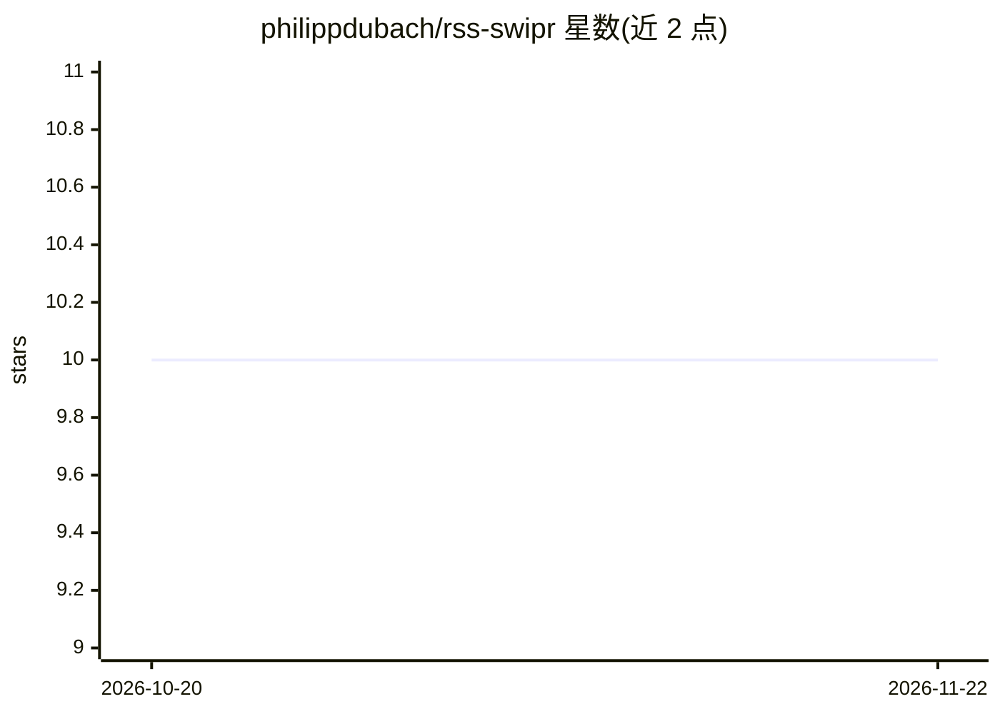

# philippdubach/rss-swipr

⭐ 10 · Python · MIT · 推送 2026-02-21 · [GitHub](https://github.com/philippdubach/rss-swipr) · [官网](https://philippdubach.com/standalone/rss-tinder/) · 个人维护

**滑动式 RSS 阅读器，学习偏好并个性化推荐文章**

基于 Flask 的本地 RSS 阅读器，用户以滑动（右=喜欢、左=不喜欢、上=中性）方式标注文章，应用记录投票、点击与阅读时长构建训练数据；积累 50+ 投票后可在 Google Colab 训练个性化模型并上传 .pkl 启用推荐。推荐采用 Thompson Sampling（80% 利用/20% 探索），结合文本与行为混合特征。所有数据存于本地 SQLite，无云依赖。需 Python 3.8+ 及 Flask、pandas、scikit-learn、xgboost、feedparser。

## 筛选速览

| 维度 | 判定 | 备注 |
|---|---|---|
| AI 角色 | `ai-native` | 本体是模型或模型工具 |
| 许可风险 | `permissive` | MIT |
| 部署形态 | `None` |  |
| 模型依赖 | — | README 未给出锁定关系 |
| 硬件要求 | — | 无带数字的原话,不猜 |
| 安装摩擦 | `low` | 无编译、无系统依赖或容器化 |
| 成熟度 | — | 结构信号不足 |

## 能力要点

- 滑动交互收集投票、点击、阅读时长作为训练信号
- Google Colab 笔记本训练模型并上传 .pkl 启用推荐
- Thompson Sampling 80/20 利用-探索策略与混合特征
- 数据本地化存储于 SQLite，无云依赖

## 适用场景

- 滑动阅读 RSS 并获得个性化文章推荐
- 导出/导入训练数据在新设备恢复偏好
- 本地自托管阅读器并自主训练推荐模型

## 场景标签

`推荐系统` · 领域:学习与行业

## 证据(README 行号)

> L3: A swipe-based RSS reader that learns your preferences. Swipe through articles to train a personalized ML model that 
> L59: - **Thompson Sampling**: 80% exploit (best predictions), 20% explore (diversity)

## 星数曲线

2026-10-20 10 → 2026-11-22 10（+0）

---
*卡片 v1 · prompt 1.4 · 生成 2026-11-19 · 置信度 high · 依据 README sha `cb9a8c1e4b6b` · [字段定义](../../DATASET.md)*
