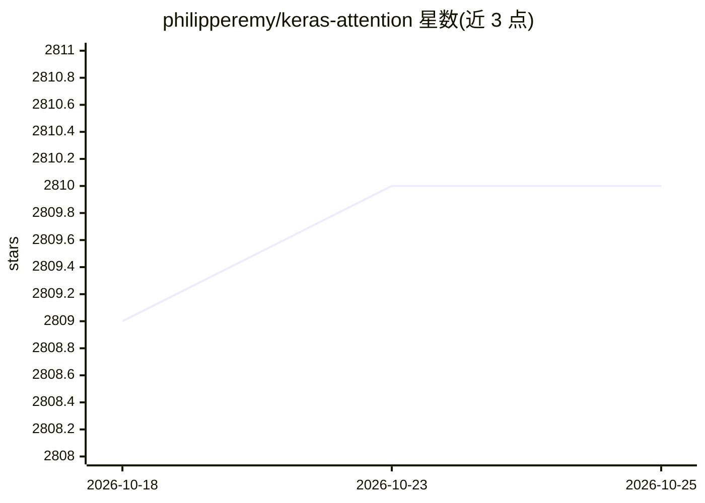

# philipperemy/keras-attention

⭐ 2,810 · Python · Apache-2.0 · 推送 2026-03-12 · [GitHub](https://github.com/philipperemy/keras-attention) · 个人维护

**Keras 注意力层库：实现 Luong 与 Bahdanau 打分函数**

面向深度学习开发者的 Keras 注意力层 Python 库，提供 Attention 层，支持 Luong 乘性打分与 Bahdanau 加性打分两种方式；输入为 3D 张量 (batch_size, timesteps, input_dim)，输出 2D 张量，并可可视化注意力权重。通过 PyPI 以 pip install attention 安装，在 TensorFlow 2.8–2.14 上测试。附 IMDB 分类、加法任务、序列最大值等示例，README 报告在 IMDB 上带注意力的 LSTM 准确率 87.62（平均）对比无注意力 87.02。

## 筛选速览

| 维度 | 判定 | 备注 |
|---|---|---|
| AI 角色 | `ai-native` | 本体是模型或模型工具 |
| 许可风险 | `permissive` | Apache-2.0 |
| 部署形态 | `library` | 以包/库形式分发 |
| 模型依赖 | — | README 未给出锁定关系 |
| 硬件要求 | — | 无带数字的原话,不猜 |
| 安装摩擦 | `low` | 无编译、无系统依赖或容器化 |
| 成熟度 | — | 结构信号不足 |

## 能力要点

- Attention 层支持 luong 与 bahdanau 两种打分函数
- 在 TensorFlow 2.8 至 2.14 上测试
- 支持注意力权重可视化（examples/add_two_numbers.py）
- 提供 IMDB、加法、序列最大值等多个示例与基准结果

## 适用场景

- 在 Keras/TensorFlow 序列模型中加入注意力机制
- 可视化模型学到的注意力分布验证行为
- 复现注意力机制的对比实验

## 场景标签

 · 领域:深度学习/神经网络组件

## 证据(README 行号)

> L7: Attention Layer for Keras. Supports the score functions of Luong and Bahdanau.
> L31: - `units`: Integer. The number of (output) units in the attention vector ($a_t$).

## 星数曲线

2026-10-18 2,809 → 2026-10-25 2,810（+1）

---
*卡片 v1 · prompt 1.4 · 生成 2026-10-21 · 置信度 high · 依据 README sha `8809410d1bd4` · [字段定义](../../DATASET.md)*
