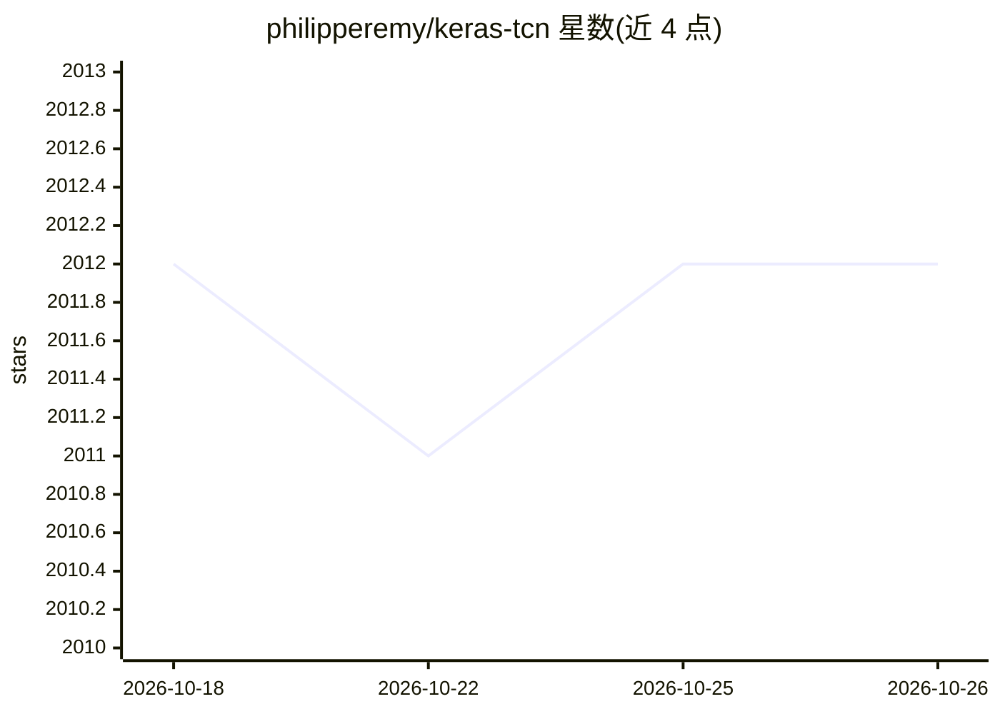

# philipperemy/keras-tcn

⭐ 2,012 · Python · MIT · 推送 2026-06-16 · [GitHub](https://github.com/philipperemy/keras-tcn) · 个人维护

**给开发者的 Keras 时间卷积网络（TCN）层实现库**

在 Keras/TF2 中提供 TCN（Temporal Convolutional Network）层的 Python 库，另附 R 语言可用示例。TCN 以膨胀因果卷积处理序列建模，接口与 LSTM 层类似（nb_filters、dilations、return_sequences 等参数），支持非因果模式与变长序列输入。仓库附带 Adding Task、Copy Memory、Sequential MNIST、Word PTB 等任务示例及参数选择经验说明。经 TensorFlow 2.9–2.19 版本测试，macOS GPU 需另装 tensorflow-metal。

## 筛选速览

| 维度 | 判定 | 备注 |
|---|---|---|
| AI 角色 | `ai-native` | 本体是模型或模型工具 |
| 许可风险 | `permissive` | MIT |
| 部署形态 | `library` | 以包/库形式分发 |
| 模型依赖 | — | README 未给出锁定关系 |
| 硬件要求 | — | 无带数字的原话,不猜 |
| 安装摩擦 | `low` | 无编译、无系统依赖或容器化 |
| 成熟度 | — | 结构信号不足 |

## 能力要点

- 提供 Keras TCN 层，参数接口与 LSTM 层类似
- 支持 causal/non-causal 两种 padding 模式与变长序列输入
- 附带 Adding/Copy Memory/Sequential MNIST/Word PTB 示例任务与训练结果
- 经 TensorFlow 2.9–2.19 测试，另附 R 语言示例

## 适用场景

- 在 Keras 中用 TCN 替代 LSTM/GRU 做序列建模
- 长序列任务（Sequential MNIST、Copy Memory 等）的模型搭建
- 按膨胀率/卷积核配置调整感受野以匹配序列长度

## 场景标签

 · 领域:深度学习/序列建模

## 证据(README 行号)

> L3: *Keras Temporal Convolutional Network*. [paper]
> L18: ## Why TCN (Temporal Convolutional Network) instead of LSTM/GRU?

## 星数曲线

2026-10-18 2,012 → 2026-10-26 2,012（+0）

---
*卡片 v1 · prompt 1.4 · 生成 2026-10-21 · 置信度 high · 依据 README sha `6552b706c98c` · [字段定义](../../DATASET.md)*
