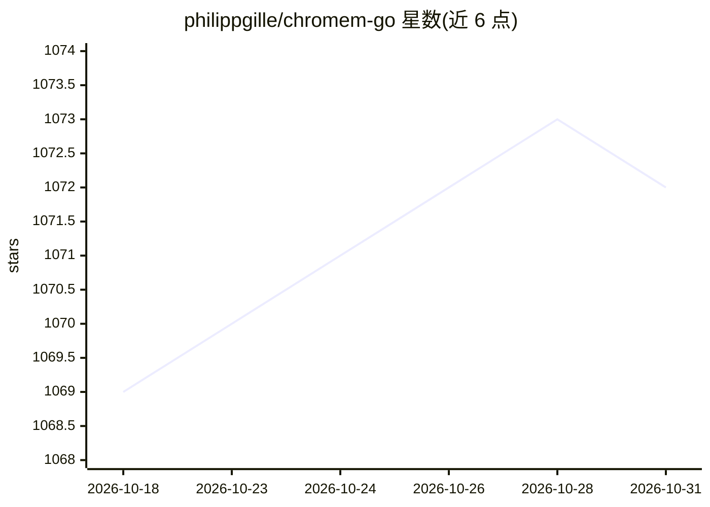

# philippgille/chromem-go

⭐ 1,072 · Go · MPL-2.0 · 推送 2026-09-06 · [GitHub](https://github.com/philippgille/chromem-go) · 个人维护

**可嵌入 Go 应用的向量数据库，零第三方依赖，支持 RAG**

以库形式嵌入 Go 程序的向量数据库，接口设计受 Chroma 启发但独立实现，无需运行独立数据库进程。内存存储，可选持久化与单文件备份导出（gob 编码，可选 gzip/AES-GCM 加密）。相似度检索采用基于余弦相似度的穷举最近邻搜索；内置 OpenAI、Azure OpenAI、GCP Vertex AI、Cohere、Mistral、Jina、Ollama、LocalAI 等嵌入提供方，也支持自带嵌入。项目处于 beta 阶段，v1.0.0 前可能引入破坏性变更。

## 筛选速览

| 维度 | 判定 | 备注 |
|---|---|---|
| AI 角色 | `ai-ecosystem` | LLM/agent 周边工具 |
| 许可风险 | `permissive` | MPL-2.0 |
| 部署形态 | `library` | 以包/库形式分发 |
| 模型依赖 | local-ok | 支持本地模型 |
| 硬件要求 | — | 无带数字的原话,不猜 |
| 安装摩擦 | `low` | 无编译、无系统依赖或容器化 |
| 成熟度 | `idea` | |

## 能力要点

- 零第三方依赖，可像 SQLite 一样嵌入 Go 应用
- 内置 10 种托管与本地嵌入提供方，支持自定义 EmbeddingFunc
- 余弦相似度穷举最近邻搜索，含文档与元数据过滤
- 可选持久化与整库单文件导出/导入（可选 AES-GCM 加密）

## 适用场景

- 在 Go 应用中添加 RAG 或语义搜索功能而不维护独立数据库
- 本地通过 Ollama 运行嵌入模型的 RAG 流程
- 将向量检索嵌入需要轻量部署的应用

## 场景标签

`向量数据库` · 领域:知识与检索

## 证据(README 行号)

> L10: Because `chromem-go` is embeddable it enables you to add retrieval augmented generation (RAG) and similar embedding
> L80: - [X] Zero dependencies on third party libraries
> L94:  - [X] Ollama

## 星数曲线

2026-10-18 1,069 → 2026-10-31 1,072（+3）

---
*卡片 v1 · prompt 1.4 · 生成 2026-10-21 · 置信度 high · 依据 README sha `52aeba958b62` · [字段定义](../../DATASET.md)*
