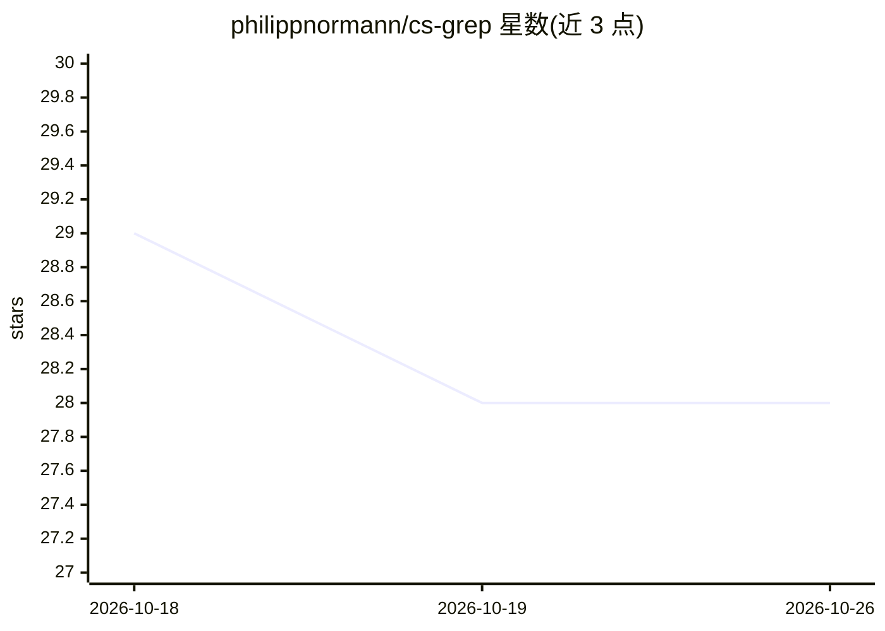

# philippnormann/cs-grep

⭐ 28 · Rust · MIT · 推送 2026-09-18 · [GitHub](https://github.com/philippnormann/cs-grep) · 个人维护

**本地索引计算机科学文献的 CLI/TUI 检索工具**

用 Rust 编写的命令行与终端界面论文检索工具：从 DBLP 构建本地 SQLite/FTS5 索引，支持对标题、作者、摘要、会议、年份、排名、标签和 DOI 的表达式查询（AND/OR/NOT、短语、前缀、范围年份）。按 bundle 选择领域会议目录（默认 security/ml/se，可扩展 hci），可选从 OpenAlex、Semantic Scholar、OpenReview 补充摘要（无需 API key）。结果可导出 CSV/JSON/BibTeX。面向需要快速脚本化文献检索的科研用户。

## 筛选速览

| 维度 | 判定 | 备注 |
|---|---|---|
| AI 角色 | `ai-knowledge` | 知识聚合/清单类 |
| 许可风险 | `permissive` | MIT |
| 部署形态 | `library` | 以包/库形式分发 |
| 模型依赖 | — | README 未给出锁定关系 |
| 硬件要求 | — | 无带数字的原话,不猜 |
| 安装摩擦 | `low` | 无编译、无系统依赖或容器化 |
| 成熟度 | — | 结构信号不足 |

## 能力要点

- 基于 DBLP 的本地 SQLite/FTS5 索引，支持 CLI 与 TUI
- 全文+元数据过滤的表达式查询语言（venue/year/rank/tag/doi）
- 可配置会议目录与标签 bundle，支持自定义 venue
- 导出 CSV/JSON/BibTeX，摘要增强无需 API key

## 适用场景

- 本地快速检索特定会议/年份/等级的论文
- 文献综述时按 venue 与 rank 过滤结果
- 在脚本中用查询语言批量获取论文元数据

## 场景标签

 · 领域:学术检索工具

## 证据(README 行号)

> L7: `cs-grep` builds a local SQLite/FTS5 index from DBLP and gives you a clean CLI
> L13: - Search across configurable computer science venue catalogs.

## 星数曲线

2026-10-18 29 → 2026-10-26 28（-1）

---
*卡片 v1 · prompt 1.4 · 生成 2026-10-26 · 置信度 mid · 依据 README sha `a52f99925512` · [字段定义](../../DATASET.md)*
