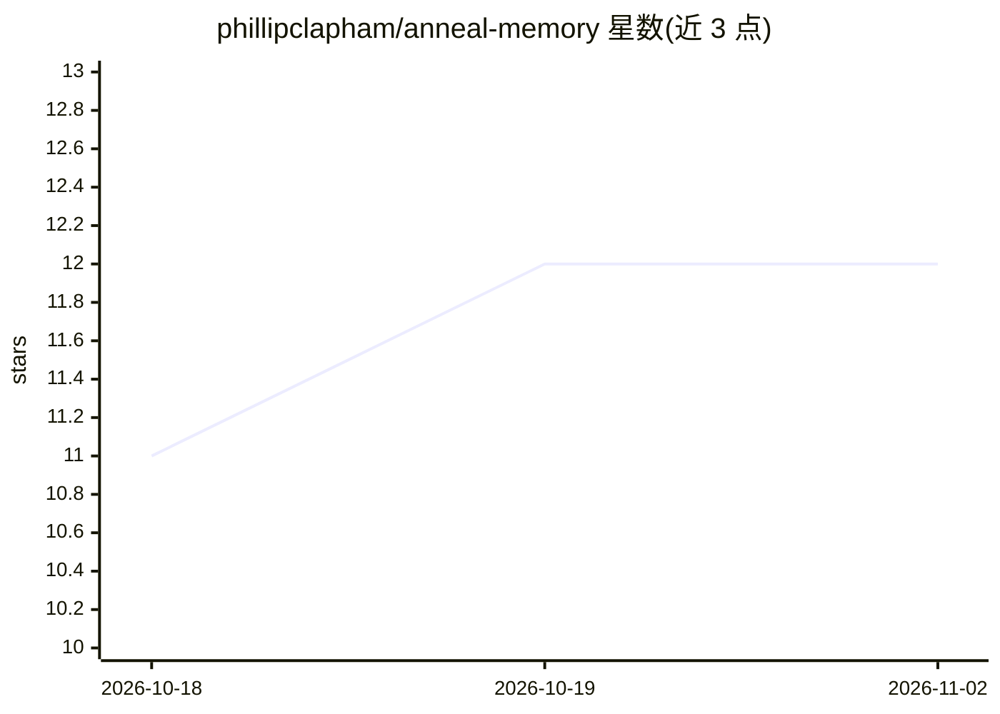

# phillipclapham/anneal-memory

⭐ 12 · Python · MIT · 推送 2026-11-01 · [GitHub](https://github.com/phillipclapham/anneal-memory) · 个人维护

**给 AI agent 开发者的本地长期记忆库：情景压缩为身份，带引用校验**

面向 agent 开发者与运营者的本地记忆存储库：追加式情景日志经单一写入者整合为 agent 常载的身份层，模式晋升需引用真实情景 ID，引用失败则降级；含哈希链审计日志、前瞻任务 spores 与整合 baton 门控（整合需操作者手动授权）。零依赖（仅 Python 标准库）、不用嵌入，本地存储。提供 Python 库、运维 CLI 与 MCP server 三种接入方式，兼容 Claude Code、Codex、Gemini CLI 等 MCP 客户端，并为 LangGraph、CrewAI 等框架提供集成指南。Windows 上文件锁退化为无锁，并发写入存在竞态限制。

## 筛选速览

| 维度 | 判定 | 备注 |
|---|---|---|
| AI 角色 | `ai-ecosystem` | LLM/agent 周边工具 |
| 许可风险 | `permissive` | MIT |
| 部署形态 | `library` | 以包/库形式分发 |
| 模型依赖 | — | README 未给出锁定关系 |
| 硬件要求 | — | 无带数字的原话,不猜 |
| 安装摩擦 | `low` | 无编译、无系统依赖或容器化 |
| 成熟度 | — | 结构信号不足 |

## 能力要点

- 情景日志→身份层压缩的 CLS 式架构，模式晋升需通过引用校验
- 哈希链防篡改审计日志与人工门控的整合（baton claim）机制
- 零依赖（Python stdlib only）、本地存储、无需嵌入
- Python 库 / CLI / MCP server 三种接入共享同一管线

## 适用场景

- 为我的 agent 添加跨会话持久记忆与身份连续性
- 在 MCP 客户端（Claude Code/Codex/Gemini CLI）中挂载可审计的记忆层
- 控制哪些记忆可晋升为长期身份，防止记忆污染

## 场景标签

`Agent 记忆` · 领域:Agent 开发

## 证据(README 行号)

> L19: An append-only episodic log, consolidated by a single writer into a versioned identity the agent always loads, with
> L105: ### All Three Paths, Same Cognitive Loop
> L121: anneal-memory works with any agent framework through the Python library. Each guide below shows where to call the 

## 星数曲线

2026-10-18 11 → 2026-11-02 12（+1）

---
*卡片 v1 · prompt 1.4 · 生成 2026-11-01 · 置信度 high · 依据 README sha `6f1684ee7a08` · [字段定义](../../DATASET.md)*
