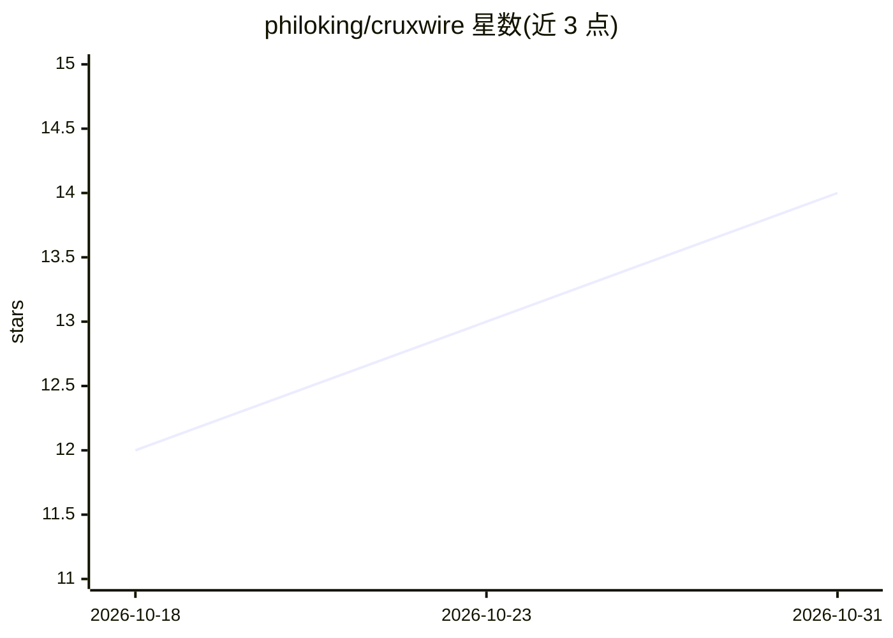

# philoking/cruxwire

⭐ 14 · HTML · MIT · 推送 2026-06-28 · [GitHub](https://github.com/philoking/cruxwire) · [官网](https://cruxwire.app) · 个人维护

**自托管本地 LLM 新闻阅读器：对 RSS 源打分、去重、摘要**

单容器自部署的新闻聚合面板：后台管线定时抓取 RSS/Atom 源，通过本地 Ollama 模型对文章打 0-10 相关性分、生成摘要与分类，用嵌入余弦相似度聚合同题报道，并根据阅读行为学习偏好。提供语义搜索、按需全文 TL;DR、多设备阅读状态同步。纯 Python stdlib 无依赖，面向单用户私有网络，无身份认证，需外部 Ollama 服务（默认 qwen3:8b 与 nomic-embed-text）。

## 筛选速览

| 维度 | 判定 | 备注 |
|---|---|---|
| AI 角色 | `ai-native` | 本体是模型或模型工具 |
| 许可风险 | `permissive` | MIT |
| 部署形态 | `self-host` | docker 或自建部署 |
| 模型依赖 | local-ok | 支持本地模型 |
| 硬件要求 | — | 无带数字的原话,不猜 |
| 安装摩擦 | `low` | 无编译、无系统依赖或容器化 |
| 成熟度 | — | 结构信号不足 |

## 能力要点

- 本地 Ollama 模型打分（0-10）、摘要、分类，类别由用户兴趣描述自定义
- 嵌入相似度跨源去重聚合同题报道
- 语义搜索与按需全文 TL;DR，多设备读/稍后读/历史同步
- 纯 stdlib 无 Python 依赖，单容器部署，设置运行时热更新

## 适用场景

- 私有化聚合自己的 RSS 源并按个人兴趣排序阅读
- 把多篇同题报道折叠成一张卡片减少重复信息
- 稍后读时自动生成全文要点 TL;DR

## 场景标签

`语义搜索` · 领域:知识与检索

## 证据(README 行号)

> L8: A personal news dashboard in a **single container**. A background pipeline fetches RSS/Atom feeds,
> L9: uses a local LLM (via Ollama) to score, summarise, and de-duplicate articles,
> L19: - **LLM-ranked digest** - every article gets a 0-10 relevance score, a 1-2 sentence summary, and a

## 星数曲线

2026-10-18 12 → 2026-10-31 14（+2）

---
*卡片 v1 · prompt 1.4 · 生成 2026-10-31 · 置信度 high · 依据 README sha `5e1998f3ea55` · [字段定义](../../DATASET.md)*
