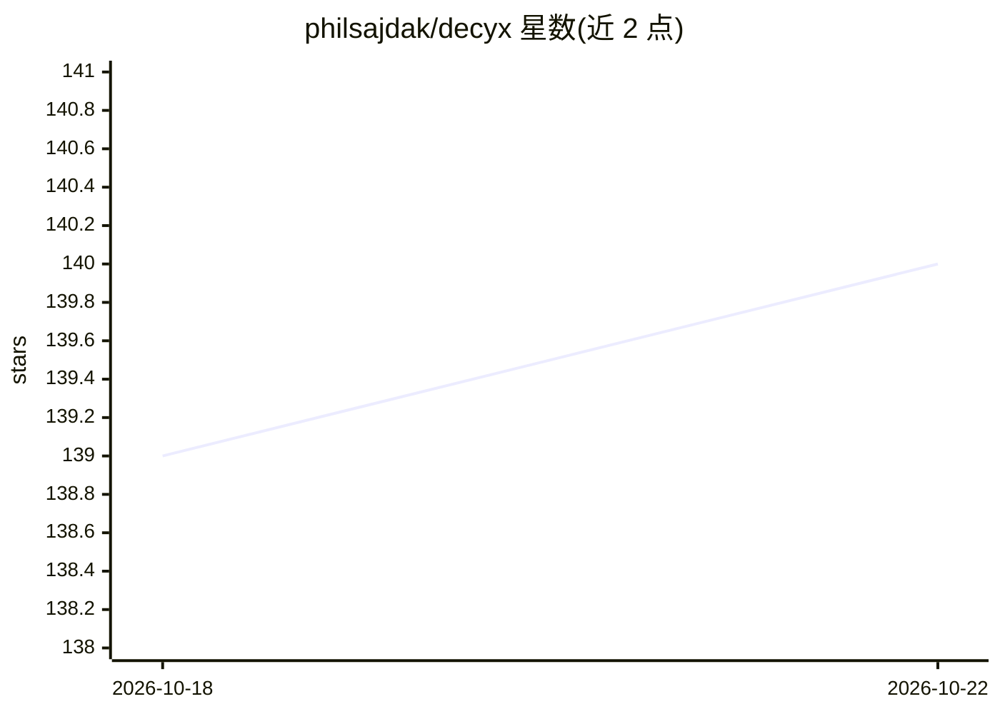

# philsajdak/decyx

⭐ 140 · Python · MIT · 推送 2026-03-06 · [GitHub](https://github.com/philsajdak/decyx) · [官网](https://www.decyx.com) · 个人维护

**Ghidra 扩展：用 Claude 辅助逆向工程与二进制分析**

面向逆向工程者的 Ghidra 脚本扩展，通过 Anthropic Claude API 为函数与变量重命名、类型推断、反编译代码解释和逐行注释生成建议；调用方函数的反编译代码可纳入上下文。每一步建议均经 GUI 交互审核、可编辑提示词后再应用，模型不直接改动 Ghidra 工程。需 Ghidra >= 11.1.2 与 Claude API key，通过 Script Manager 添加目录安装，脚本以 Jython 运行时维持与 Ghidra 12.0 之前版本的兼容。

## 筛选速览

| 维度 | 判定 | 备注 |
|---|---|---|
| AI 角色 | `ai-native` | 本体是模型或模型工具 |
| 许可风险 | `permissive` | MIT |
| 部署形态 | `None` |  |
| 模型依赖 | locked-api |  |
| 硬件要求 | — | 无带数字的原话,不猜 |
| 安装摩擦 | `low` | 无编译、无系统依赖或容器化 |
| 成熟度 | — | 结构信号不足 |

## 能力要点

- AI 辅助函数/变量重命名与类型推断（无效类型先高亮提示）
- 反编译函数代码解释与逐行注释生成
- 调用方函数上下文纳入建议生成
- GUI 逐步审核与可编辑提示词，模型不强制修改工程

## 适用场景

- 逆向分析时为未识别函数批量生成可读命名建议
- 为反编译代码生成解释与注释辅助理解
- 在保持人工把关的前提下自动化部分分析流程

## 场景标签

`网络安全` · 领域:学习与行业

## 证据(README 行号)

> L3: Decyx is an __extension for Ghidra that leverages AI to assist in reverse engineering and binary analysis__.
> L5: It uses Anthropic's Claude API to provide intelligent suggestions for function and variable renaming, type inference

## 星数曲线

2026-10-18 139 → 2026-10-22 140（+1）

---
*卡片 v1 · prompt 1.4 · 生成 2026-10-22 · 置信度 high · 依据 README sha `629d448c4278` · [字段定义](../../DATASET.md)*
