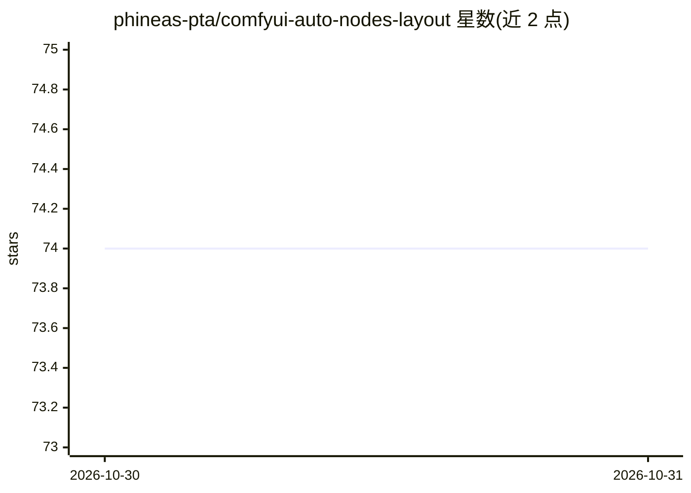

# phineas-pta/comfyui-auto-nodes-layout

⭐ 74 · JavaScript · Unlicense · 推送 2026-05-19 · [GitHub](https://github.com/phineas-pta/comfyui-auto-nodes-layout) · [官网](https://registry.comfy.org/nodes/comfyui-auto-nodes-layout) · 个人维护

**ComfyUI 工作流节点自动布局扩展，改善可视化连线**

ComfyUI 自定义节点扩展：针对工作流（有向无环图）应用分层图绘制算法替代 LiteGraph.js 默认 auto-arrange，使连线方向与节点归属更清晰。实现 Dagre 与 ELK layered 两种布局算法，可调整列间距与同列节点间距；使用前建议移除 ReRoute 节点。通过 ComfyUI Manager 或 git clone 安装，需 ComfyUI ≥ 0.12.3，无额外依赖。作者声明这是概念验证原型，常产生更大的图，且存在布局改动需 Undo+Redo 后才可见的已知问题。

## 筛选速览

| 维度 | 判定 | 备注 |
|---|---|---|
| AI 角色 | `ai-ecosystem` | LLM/agent 周边工具 |
| 许可风险 | `permissive` | Unlicense |
| 部署形态 | `None` |  |
| 模型依赖 | — | README 未给出锁定关系 |
| 硬件要求 | — | 无带数字的原话,不猜 |
| 安装摩擦 | `low` | 无编译、无系统依赖或容器化 |
| 成熟度 | `idea` | |

## 能力要点

- 提供 Dagre 与 ELK layered 两种分层布局算法
- 可调列水平间距与同列节点垂直间距
- 经 ComfyUI Manager 一键安装，无额外依赖
- 实现思路来自 ComfyUI issue #1547 的概念验证

## 适用场景

- ComfyUI 工作流连线杂乱时重新自动排版
- 希望工作流流向和连接归属更易读时应用分层布局

## 场景标签

 · 领域:AI 工作流工具/图可视化

## 证据(README 行号)

> L3: a ComfyUI extension that applies an improved node layout algorithm to ComfyUI workflows, primarily for better visual
> L48: requirements: ComfyUI version ≥ 0.12.3

## 星数曲线

2026-10-30 74 → 2026-10-31 74（+0）

---
*卡片 v1 · prompt 1.4 · 生成 2026-10-30 · 置信度 high · 依据 README sha `ef7569d0cefd` · [字段定义](../../DATASET.md)*
