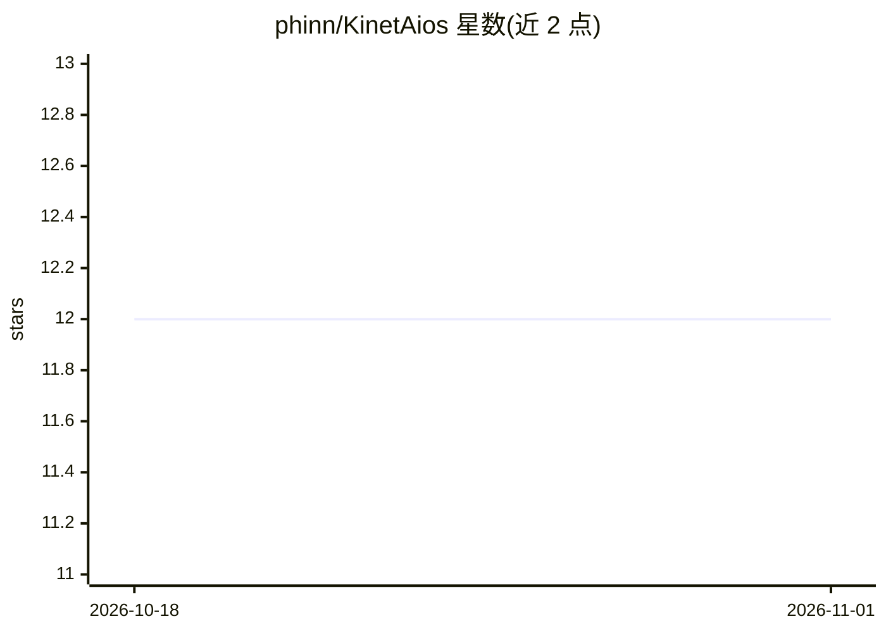

# phinn/KinetAios

⭐ 12 · TypeScript · GPL-3.0 · 推送 2026-10-31 · [GitHub](https://github.com/phinn/KinetAios) · [官网](https://phinn.github.io/KinetAios/) · 个人维护 · 中文 README

**本地优先的多引擎 AI agent 桌面工作台，无账号无中转**

面向 Windows 11 与 macOS 的 Electron 桌面应用：在单一窗口内并行运行多个 agent 会话，引擎包括自研 Direct V1/V2/V3（ReAct/Plan-Execute-Verify/DAG 并行）、Claude Code CLI、Codex CLI 与 DeepSeek Harness，可按会话切换并经 Pipeline 跨引擎编排。内置 30+ 工具（shell/文件/搜索/截图/Computer Use）、MCP 客户端与服务端、本地 SQLite 长期记忆（跨引擎共享）、技能自动扫描与插件系统。仅需用户自有 API key，无账号与中转服务器；从 release 安装包或 npm 源码运行。

## 筛选速览

| 维度 | 判定 | 备注 |
|---|---|---|
| AI 角色 | `ai-native` | 本体是模型或模型工具 |
| 许可风险 | `viral` | GPL-3.0 |
| 部署形态 | `desktop` | 安装包/桌面程序 |
| 模型依赖 | — | README 未给出锁定关系 |
| 硬件要求 | — | 无带数字的原话,不猜 |
| 安装摩擦 | `low` | 无编译、无系统依赖或容器化 |
| 成熟度 | — | 结构信号不足 |

## 能力要点

- 四引擎（Direct V1/V2/V3 + Claude Code + Codex + DeepSeek Harness）按会话切换，Pipeline 跨引擎编排
- 本地 SQLite 长期记忆，跨引擎/会话共享并可视化记忆图谱
- 30+ 内置工具 + MCP 客户端/服务端 + 插件 SDK v3（21 个内置插件）
- 本地优先：API key 为唯一凭证，无账号无中转

## 适用场景

- 在本地并行管理多个 AI agent 会话并跟踪 token 成本
- 在 Claude Code、Codex 与自研引擎间切换并保留共享记忆
- 经 MCP 接入外部工具，或让远程机器调用本地 agent

## 场景标签

`AI 助手` `Agent 记忆` · 领域:Agent 开发

## 证据(README 行号)

> L20: A **local-first AI agent dashboard** for **Windows 11 and macOS — both first-class platforms** (the "Win" folder na
> L24: - 🔀 **Four engines, one window** — Direct (in-house ReAct) + Claude Code + Codex + DeepSeek Harness; switch per ses

## 星数曲线

2026-10-18 12 → 2026-11-01 12（+0）

---
*卡片 v1 · prompt 1.4 · 生成 2026-11-01 · 置信度 high · 依据 README sha `02741b39f49b` · [字段定义](../../DATASET.md)*
