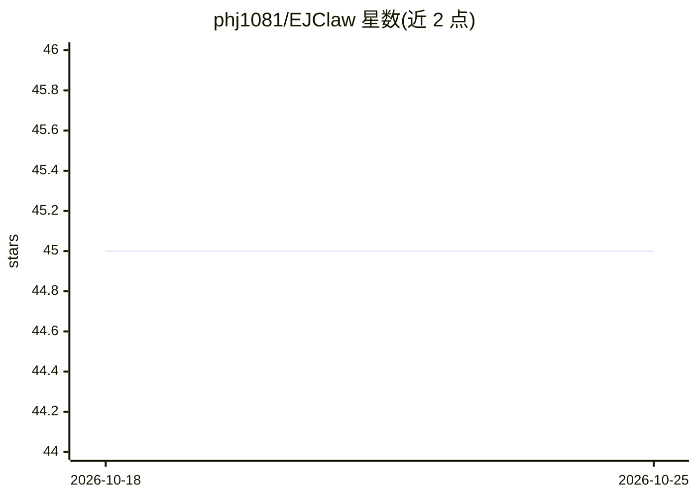

# phj1081/EJClaw

⭐ 45 · TypeScript · 推送 2026-07-25 · [GitHub](https://github.com/phj1081/EJClaw) · 个人维护

**基于上游 NanoClaw 的 agent 栈 carry 补丁镜像与重建手册**

EJClaw v2 不再是独立应用，而是 EYEJOKER agent 栈在 upstream NanoClaw 之上的最小自定义 carry 层仓库：镜像 carry 分支提交（Discord adapter、host-executor MCP、mount allowlist 等补丁），并给出在 algo 主机上重建完整服务的步骤——clone 上游、cherry-pick carry 补丁、systemd 部署、.env 配置与 pnpm 构建后用 ncl CLI 重新生成 wiring。栈内含 Codex OAuth 池转 Anthropic 兼容端点的 cliproxyapi、AgentMemory MCP 知识层。旧 Tribunal v0.x 栈已归档退役。

## 筛选速览

| 维度 | 判定 | 备注 |
|---|---|---|
| AI 角色 | `ai-ecosystem` | LLM/agent 周边工具 |
| 许可风险 | `none` | — |
| 部署形态 | `library` | 以包/库形式分发 |
| 模型依赖 | — | README 未给出锁定关系 |
| 硬件要求 | — | 无带数字的原话,不猜 |
| 安装摩擦 | `low` | 无编译、无系统依赖或容器化 |
| 成熟度 | — | 结构信号不足 |

## 能力要点

- carry 补丁以独立分支提交维护，上游更新时 rebase
- 服务组成：nanoclaw-v2 本体、host-executor MCP（含审计日志）、cliproxyapi（Codex OAuth→Anthropic 兼容端点）
- 提供 algo 主机完整重建步骤（git clone + cherry-pick + systemd + pnpm build）
- 旧 v0.x 栈于 2026-07-14 退役并归档保存

## 适用场景

- 在新的主机上按手册重建 EYEJOKER agent 栈
- 追踪上游 NanoClaw 之上的最小自定义补丁历史
- 了解该 Discord 多 agent 栈的服务组成与运营原则

## 场景标签

`多智能体` `浏览器自动化` · 领域:Agent 开发

## 证据(README 行号)

> L3: EJClaw는 더 이상 독립 앱이 아니다. **업스트림 NanoClaw + 최소 커스텀**으로 운용하는
> L11: upstream nanoclaw (github.com/nanocoai/nanoclaw, main)

## 星数曲线

2026-10-18 45 → 2026-10-25 45（+0）

---
*卡片 v1 · prompt 1.4 · 生成 2026-10-25 · 置信度 mid · 依据 README sha `3baca8713ab0` · [字段定义](../../DATASET.md)*
