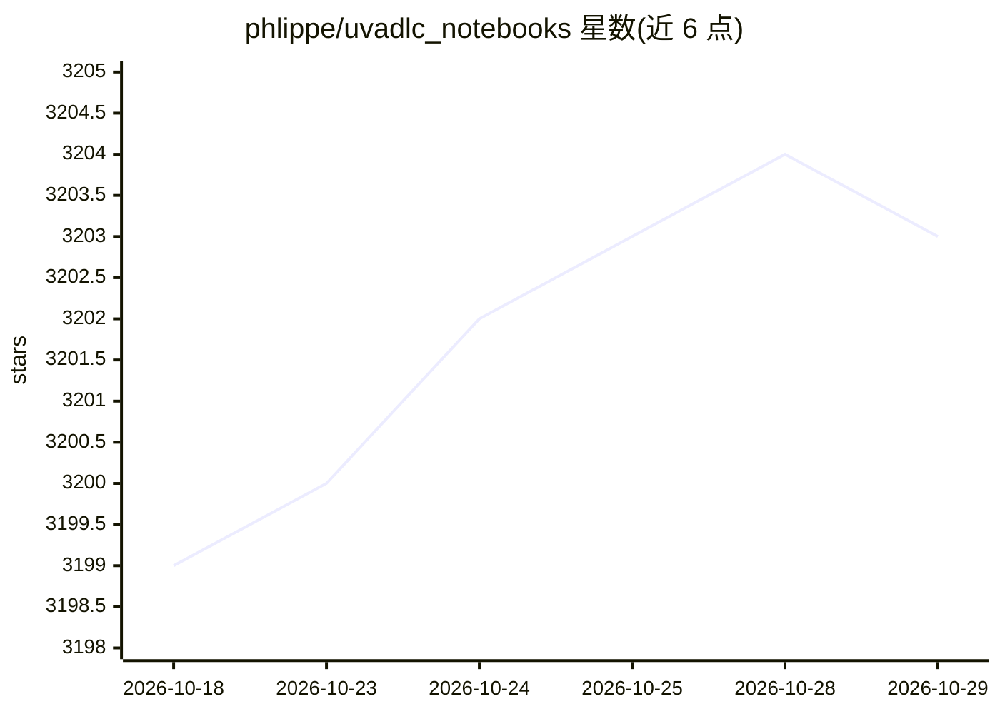

# phlippe/uvadlc_notebooks

⭐ 3,203 · Jupyter Notebook · MIT · 推送 2026-06-01 · [GitHub](https://github.com/phlippe/uvadlc_notebooks) · [官网](https://uvadlc-notebooks.readthedocs.io/en/latest/) · 组织维护

**阿姆斯特丹大学深度学习课程的 Jupyter 教程笔记本集**

为阿姆斯特丹大学 MSc AI 深度学习课程（Fall 2024）编写的系列 Jupyter 教程笔记本，用实现演示讲授课理论，主题覆盖优化技术、Transformer、图神经网络、自监督学习等 15+ 个教程。笔记本以 PyTorch 与 PyTorch Lightning 为主，并提供 JAX+Flax 的一对一翻译版本。支持本地 CPU 运行（提供 conda 环境、自动下载预训练模型）、Google Colab 与 Snellius 集群三种方式，作者为 Phillip Lippe。

## 筛选速览

| 维度 | 判定 | 备注 |
|---|---|---|
| AI 角色 | `ai-knowledge` | 知识聚合/清单类 |
| 许可风险 | `permissive` | MIT |
| 部署形态 | `None` |  |
| 模型依赖 | — | README 未给出锁定关系 |
| 硬件要求 | — | 无带数字的原话,不猜 |
| 安装摩擦 | `low` | 无编译、无系统依赖或容器化 |
| 成熟度 | `idea` | |

## 能力要点

- PyTorch/PyTorch Lightning 实现讲解，配 JAX+Flax 一对一翻译版本
- 覆盖 Transformer、GNN、ViT、SimCLR、Normalizing Flows 等 15+ 主题
- 可在普通笔记本 CPU 上运行，预训练模型与数据集占用小于 1GB
- 教程已被集成为 PyTorch Lightning 官方教程

## 适用场景

- 跟着动手实现学习深度学习各主题
- 对比学习 PyTorch 与 JAX/Flax 两种框架写法
- 课程之外自学深度学习的配套材料

## 场景标签

`教程课程` · 领域:学习与行业

## 证据(README 行号)

> L10: For this year's course edition, we created a series of Jupyter notebooks that are designed to help you understandin
> L12: The notebooks are there to help you understand the material and teach you details of the **PyTorch** framework, inc

## 星数曲线

2026-10-18 3,199 → 2026-10-29 3,203（+4）

---
*卡片 v1 · prompt 1.4 · 生成 2026-10-20 · 置信度 high · 依据 README sha `ce71c7bc4d74` · [字段定义](../../DATASET.md)*
