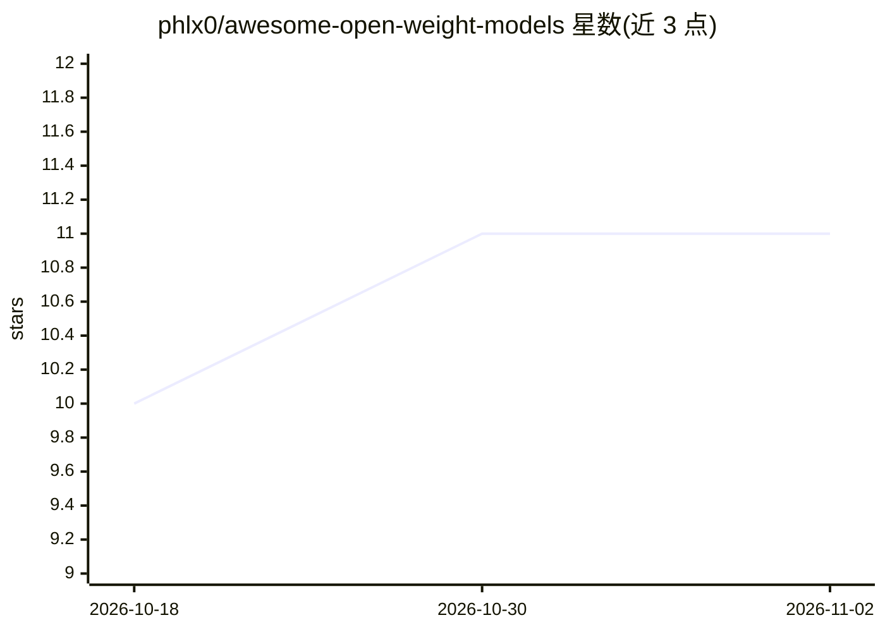

# phlx0/awesome-open-weight-models

⭐ 11 · NOASSERTION · 推送 2026-04-20 · [GitHub](https://github.com/phlx0/awesome-open-weight-models) · 个人维护

**开源权重 LLM 选型清单：许可、硬件、部署与按场景推荐**

面向工程师的开放权重语言模型实践指南：覆盖 Qwen、Gemma、Llama、DeepSeek、Mistral、Phi、GLM、Command R 八个模型家族，逐模型列出参数量、上下文长度与许可证；信息取自 Hugging Face 模型卡、官方博客与 arXiv 等一手来源。提供按用途的 Quick Pick 推荐、决策流程图、许可对照表（商业使用/衍生品/用户量上限）、BF16 与 Q4 量化下的 GPU VRAM 需求及 Apple Silicon 适配参考。表格刻意省略基准分数，改指向动态排行榜。

## 筛选速览

| 维度 | 判定 | 备注 |
|---|---|---|
| AI 角色 | `ai-knowledge` | 知识聚合/清单类 |
| 许可风险 | `none` | NOASSERTION |
| 部署形态 | `None` |  |
| 模型依赖 | — | README 未给出锁定关系 |
| 硬件要求 | — | 无带数字的原话,不猜 |
| 安装摩擦 | `low` | 无编译、无系统依赖或容器化 |
| 成熟度 | — | 结构信号不足 |

## 能力要点

- 覆盖 8 个模型家族的逐模型参数、上下文与许可证信息
- 许可对照表标注商业使用、衍生品与用户量上限（如 >100M MAU、>700M MAU 条款）
- BF16 与 Q4_K_M 量化两档 GPU VRAM 需求表及 Apple Silicon 推荐
- 按用途的 Quick Pick 默认推荐与决策流程图

## 适用场景

- 选型时核对某开放权重模型的许可证与商业限制
- 根据手头 GPU 显存筛选可运行的模型与量化方案
- 按编码、推理、Agent、端侧等场景找默认模型推荐

## 场景标签

`精选清单` · 领域:学习与行业

## 证据(README 行号)

> L3: > A practitioner-first guide to open-weight language models — verified licenses, real hardware requirements, deploym
> L13: Six major families now ship frontier-capable open-weight models under permissive licenses. The information landscap

## 星数曲线

2026-10-18 10 → 2026-11-02 11（+1）

---
*卡片 v1 · prompt 1.4 · 生成 2026-11-01 · 置信度 high · 依据 README sha `2bdf0a23d18b` · [字段定义](../../DATASET.md)*
