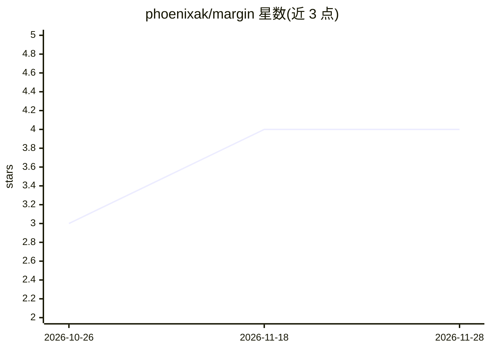

# phoenixak/margin

⭐ 4 · TypeScript · MIT · 推送 2026-10-25 · [GitHub](https://github.com/phoenixak/margin) · 个人维护

**为 Harper 语法检查器提供可选 LLM 第二遍校对**

作为 Harper 的可选 AI 第二遍：规则检查仍由 Harper 负责，Margin 仅用 LLM 捕捉规则覆盖不到的问题（跨子句一致、时态、真实词误用、漏词/重复词、连写句），并按请求改写或调整语气。通过 Ollama 本地运行 Gemma 4 或经 Gemini API 托管，本地路径文本不出机器。分发形态包括 CLI、VS Code 扩展、Chrome/Firefox 扩展、语言服务器 margin-ls 与 Obsidian 插件，各形态需与 Harper 一同安装。无服务器、无账号、无遥测。

## 筛选速览

| 维度 | 判定 | 备注 |
|---|---|---|
| AI 角色 | `ai-native` | 本体是模型或模型工具 |
| 许可风险 | `permissive` | MIT |
| 部署形态 | `library` | 以包/库形式分发 |
| 模型依赖 | local-ok | 支持本地模型 |
| 硬件要求 | — | 无带数字的原话,不猜 |
| 安装摩擦 | `low` | 无编译、无系统依赖或容器化 |
| 成熟度 | `idea` | |

## 能力要点

- 支持本地（Ollama/LM Studio）与托管（Gemini API）两条模型路径
- 分发覆盖 CLI、VS Code、Chrome/Firefox、margin-ls 语言服务器与 Obsidian 插件
- 自行 diff 每句以保证下划线位置精确，带过度编辑/否定翻转等守卫
- 无服务器、无账号、无遥测，不记录文本

## 适用场景

- 在编辑器写作时为 Harper 的规则检查补一层 AI 校对
- 用本地模型校对不想上传到托管 API 的文档
- 在浏览器中校对 GitHub issue 等文本框内容并按需改写

## 场景标签

`AI 写作` · 领域:内容生成

## 证据(README 行号)

> L3: **An optional AI second pass for Harper.** Harper's fast, rule-based checks stay in charge. Margin uses an LLM only 
> L15: Both paths use the same model, Gemma 4 26B A4B: on your own machine through Ollama (`gemma4:26b-a4b-it-qat`), or ho

## 星数曲线

2026-10-26 3 → 2026-11-28 4（+1）

---
*卡片 v1 · prompt 1.4 · 生成 2026-11-21 · 置信度 mid · 依据 README sha `22e90e003a21` · [字段定义](../../DATASET.md)*
