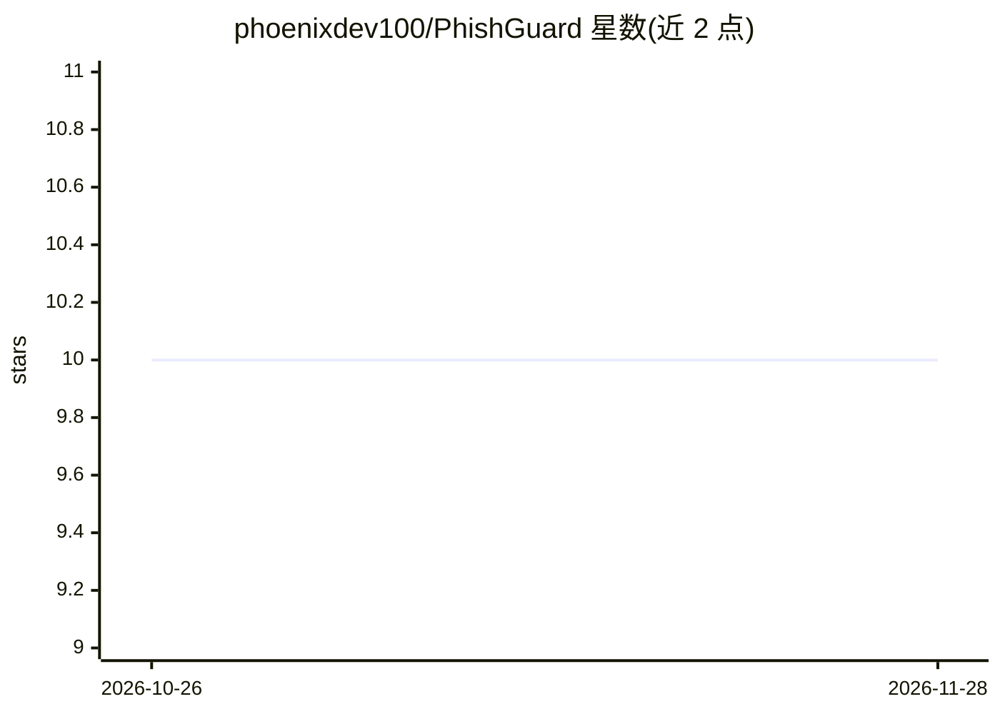

# phoenixdev100/PhishGuard

⭐ 10 · Jupyter Notebook · MIT · 推送 2026-04-06 · [GitHub](https://github.com/phoenixdev100/PhishGuard) · [官网](https://phish-guard-eight-mu.vercel.app) · 个人维护

**实时分析 URL 与网页内容检测钓鱼网站的浏览器扩展+Web 应用**

由 Flask 后端与浏览器扩展组成的钓鱼网站检测工具：对 URL 与网页内容做实时分析，结合机器学习模型预测输出置信度评分，检测特征涵盖 URL 结构、域名年龄、内容分析、SSL 证书校验、历史数据与模式识别等。扩展在用户浏览时自动检查并显示警告，提供扫描历史、通知与重试机制。安装需 Python 3.8+，通过 git clone 与 pip 安装依赖后运行 Flask 服务，扩展通过开发者模式加载。

## 筛选速览

| 维度 | 判定 | 备注 |
|---|---|---|
| AI 角色 | `ai-native` | 本体是模型或模型工具 |
| 许可风险 | `permissive` | MIT |
| 部署形态 | `library` | 以包/库形式分发 |
| 模型依赖 | — | README 未给出锁定关系 |
| 硬件要求 | — | 无带数字的原话,不猜 |
| 安装摩擦 | `low` | 无编译、无系统依赖或容器化 |
| 成熟度 | — | 结构信号不足 |

## 能力要点

- 机器学习驱动的实时 URL 与网页内容分析
- 置信度百分比评分与威胁详情展示
- 浏览器扩展自动检测并弹出钓鱼警告
- URL 扫描历史与通知系统

## 适用场景

- 浏览网页时自动拦截可疑钓鱼站点
- 手动扫描 URL 获取置信度与威胁分析
- 在浏览器中留存扫描历史便于复查

## 场景标签

`网络安全` · 领域:学习与行业

## 证据(README 行号)

> L14: - 🤖 Machine learning-based phishing detection
> L102: - Machine learning model predictions

## 星数曲线

2026-10-26 10 → 2026-11-28 10（+0）

---
*卡片 v1 · prompt 1.4 · 生成 2026-11-19 · 置信度 high · 依据 README sha `e2c7e58815d6` · [字段定义](../../DATASET.md)*
